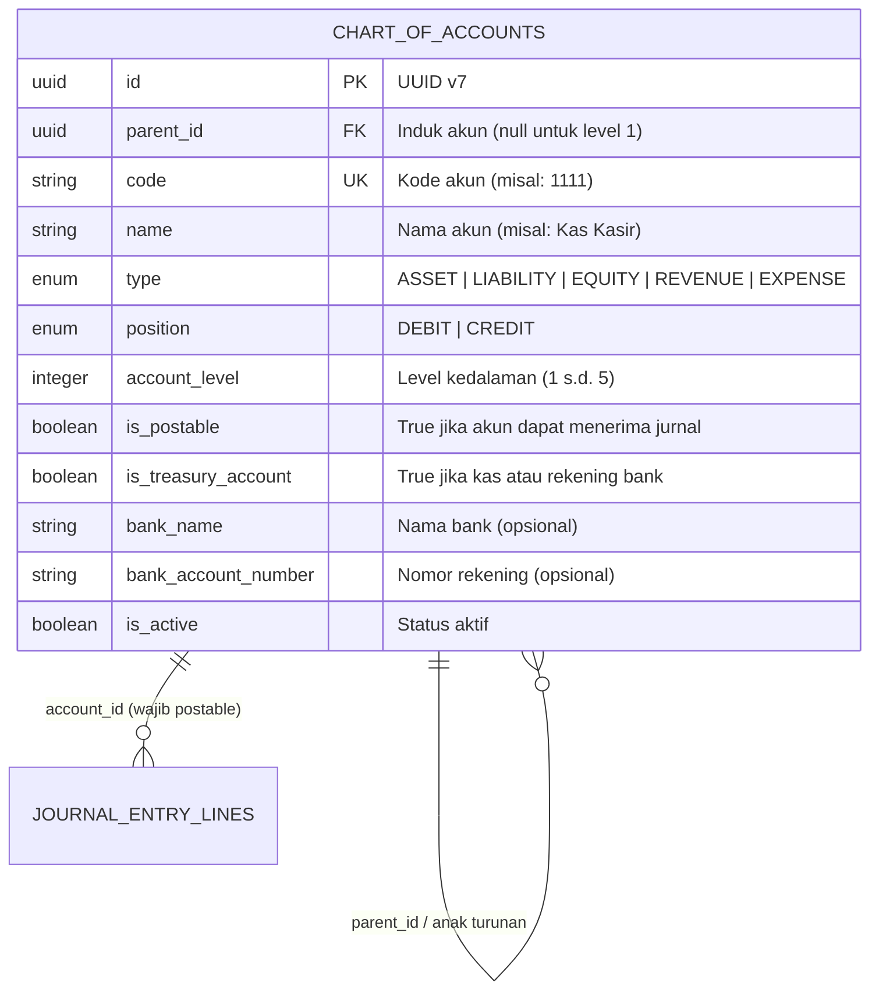

# Dokumentasi & Panduan Modul Bagan Akun / Chart of Accounts (`internal/accounting/account`)

Dokumen ini merupakan panduan lengkap arsitektur, struktur hierarki pohon (*tree structure*), aturan integritas, dan integrasi API untuk modul **Bagan Akun Standar Rumah Sakit (*Chart of Accounts - COA*)** pada sistem **HOSIM-GO**.

---

## 1. Ikhtisar & Tujuan Domain

Modul `internal/accounting/account` adalah **fondasi klasifikasi finansial seluruh sistem rumah sakit**. Modul ini menyediakan struktur kodifikasi akun standar akuntansi rumah sakit Indonesia (selaras dengan PSAK dan pedoman akuntansi RS Kemenkes).

Fungsi utama modul ini mencakup:
- **Penyedia Master Akun Terstandar**: Menampung klasifikasi akun 5 pilar utama: `ASSET` (Aset), `LIABILITY` (Kewajiban), `EQUITY` (Ekuitas), `REVENUE` (Pendapatan), dan `EXPENSE` (Beban).
- **Struktur Pohon Mandiri (*Self-Referencing Tree Hierarchy*)**: Mendukung struktur berjenjang tak terbatas dari Level 1 (Klasifikasi Utama), Level 2 (Grup/Sub-Klasifikasi), Level 3 (Kategori Akun), hingga Level 4/5 (Akun Daun/Postable).
- **Penyedia Akun Perbendaharaan (*Treasury Accounts*)**: Menandai akun kas kecil, kasir operasional, dan rekening bank rumah sakit (`is_treasury_account = true`) yang dapat dipakai oleh modul Kasir dan Billing.
- **Penyedia Validasi Penjurnalan (*Account Eligibility*)**: Membedakan akun header/kategori (`is_postable = false`) dan akun detail (`is_postable = true`) agar transaksi penjurnalan tidak salah kamar.

---

## 2. Struktur Hierarki & Logika Akuntansi

### 2.1 Model Relasi Pohon (*Self-Referencing Parent-Child*)



---

### 2.2 Klasifikasi Pokok & Posisi Saldo Normal

Secara bawaan (*default*), sistem memetakan posisi saldo normal berdasarkan tipe pilar akuntansi:

| Tipe Akun (`type`) | Kode Standar Level 1 | Saldo Normal (`position`) | Keterangan di Rumah Sakit |
|---|---|---|---|
| `ASSET` | `1000` | `DEBIT` | Kas, Bank, Piutang Pasien/BPJS, Obat/Alkes, Aset Tetap Medis |
| `LIABILITY` | `2000` | `CREDIT` | Hutang Obat PBF, Hutang Jasa Medis Dokter, Uang Muka Pasien |
| `EQUITY` | `3000` | `CREDIT` | Modal Pemilik, Saldo Laba Ditahan, Donasi/Hibah RS |
| `REVENUE` | `4000` | `CREDIT` | Pendapatan Rawat Inap, Rawat Jalan, Farmasi, Lab, Radiologi |
| `EXPENSE` | `5000` | `DEBIT` | Beban Obat/BHP, Gaji Nakes, Biaya Operasional, Depresiasi Alat |

---

### 2.3 Aturan Bisnis & Invariant (Non-Negotiable)

1. **Perlindungan Akun Klasifikasi Pokok Level 1 (*System Immutable Invariant*)**:
   Akun akar sistem (Level 1 seperti `1000 - ASET`, `2000 - KEWAJIBAN`, `3000 - EKUITAS`, `4000 - PENDAPATAN`, `5000 - BEBAN`) **DILINDUNGI SECARA PERMANEN** dari penghapusan (`ErrCannotDeleteLevelOneAccount`).
2. **Integritas Hirarki Tipe (*Type Consistency*)**:
   Akun anak **WAJIB** memiliki `type` yang sama persis dengan akun induknya (`ErrTypeMismatchWithParent`). Akun beban tidak boleh berada di bawah akun aset.
3. **Pencegahan Lingkaran Induk (*Anti-Self-Parenting*)**:
   Akun dilarang menunjuk dirinya sendiri sebagai induk (`ErrParentCannotBeSelf`).
4. **Pencegahan Akun Yatim Piatu (*No Orphan Records on Soft Delete*)**:
   Sesuai aturan [AGENTS.md](../../../AGENTS.md) Poin 6, soft-delete akun yang masih memiliki anak aktif **DITOLAK KERAS** (`ErrCannotDeleteAccountWithChildren`) di dalam transaksi atomik guna mencegah rusaknya navigasi pohon COA.
5. **Syarat Akun Perbendaharaan (*Treasury Invariant*)**:
   Akun hanya dapat ditandai sebagai akun perbendaharaan (`is_treasury_account = true`) jika:
   - Bertipe `ASSET` (`ErrTreasuryMustBeAsset`).
   - Berstatus postable `is_postable = true` (`ErrTreasuryMustBePostable`).

---

## 3. Struktur Pohon Standar Bawaan (*Standard Seeder*)

Sistem menyertakan data awal (*seeder*) bagan akun rumah sakit lengkap pada [seeder.go](seeder.go):

```text
├── 1000 - ASET (Level 1, Non-Postable)
│   ├── 1100 - Aset Lancar (Level 2, Non-Postable)
│   │   ├── 1110 - Kas dan Setara Kas (Level 3, Non-Postable)
│   │   │   ├── 1111 - Kas Kasir Rawat Jalan (Level 4, Postable, Treasury)
│   │   │   ├── 1112 - Kas Kasir Rawat Inap & IGD (Level 4, Postable, Treasury)
│   │   │   └── 1120 - Rekening Bank Operasional RS (Level 4, Postable, Treasury)
│   │   ├── 1130 - Piutang Usaha Pelayanan (Level 3, Non-Postable)
│   │   │   ├── 1131 - Piutang Pasien Umum (Level 4, Postable)
│   │   │   └── 1132 - Piutang Klaim BPJS Kesehatan (Level 4, Postable)
│   │   └── 1140 - Persediaan (Level 3, Non-Postable)
│   │       ├── 1141 - Persediaan Obat-Obatan Apotek (Level 4, Postable)
│   │       └── 1142 - Persediaan Bahan Medis Habis Pakai / BMHP (Level 4, Postable)
├── 2000 - KEWAJIBAN (Level 1, Non-Postable)
│   ├── 2100 - Kewajiban Jangka Pendek (Level 2, Non-Postable)
│   │   ├── 2110 - Hutang Usaha Farmasi/PBF (Level 3, Postable)
│   │   └── 2120 - Hutang Jasa Medis & Honor Dokter (Level 3, Postable)
├── 3000 - EKUITAS (Level 1, Non-Postable)
├── 4000 - PENDAPATAN (Level 1, Non-Postable)
│   ├── 4100 - Pendapatan Pelayanan Medis (Level 2, Non-Postable)
│   │   ├── 4110 - Pendapatan Rawat Jalan (Level 3, Postable)
│   │   ├── 4120 - Pendapatan Rawat Inap (Level 3, Postable)
│   │   └── 4130 - Pendapatan Tindakan IGD (Level 3, Postable)
└── 5000 - BEBAN (Level 1, Non-Postable)
    ├── 5100 - Beban Pelayanan & BHP (Level 2, Non-Postable)
    └── 5200 - Beban Gaji & Operasional (Level 2, Non-Postable)
```

---

## 4. Skema Basis Data (PostgreSQL)

Didefinisikan pada migration file [`migrations/00011_create_chart_of_accounts_tables.sql`](../../../migrations/00011_create_chart_of_accounts_tables.sql):

| Kolom | Tipe Data | Constraint | Keterangan |
|---|---|---|---|
| `id` | `VARCHAR(36)` | Primary Key | UUID v7 |
| `parent_id` | `VARCHAR(36)` | Nullable, FK `chart_of_accounts` | Akun induk (`ON DELETE RESTRICT`) |
| `code` | `VARCHAR(50)` | Not Null, Unique (where deleted_at is null) | Nomor kode unik akun (misal: `1111`) |
| `parent_code` | `VARCHAR(50)` | Nullable | Salinan kode akun induk |
| `name` | `VARCHAR(150)` | Not Null | Nama deskripsi akun |
| `description` | `TEXT` | Nullable | Catatan kebijakan akuntansi akun |
| `type` | `VARCHAR(30)` | Not Null, Check Enum | `ASSET`, `LIABILITY`, `EQUITY`, `REVENUE`, `EXPENSE` |
| `position` | `VARCHAR(10)` | Not Null, Check Enum | `DEBIT` atau `CREDIT` |
| `account_level` | `INTEGER` | Not Null, Check `>= 1` | Tingkat kedalaman pohon hirarki |
| `is_postable` | `BOOLEAN` | Not Null, Default true | Apakah akun boleh menerima transaksi jurnal |
| `is_treasury_account` | `BOOLEAN` | Not Null, Default false | Apakah akun perbendaharaan kas/bank |
| `bank_name` | `VARCHAR(100)` | Nullable | Nama Bank (BCA, Mandiri, BNI, dll) |
| `bank_account_number`| `VARCHAR(50)` | Nullable | Nomor rekening bank |
| `currency` | `VARCHAR(10)` | Not Null, Default 'IDR' | Mata uang standar |
| `is_active` | `BOOLEAN` | Not Null, Default true | Status aktif akun |
| `created_at`, `updated_at`, `deleted_at` | `TIMESTAMPTZ` | Standard Audit | Soft delete dengan pelindung hierarki |

---

## 5. Daftar Endpoint REST API

Semua rute bernaung di bawah prefix `/api/v1/accounting/accounts`:

| Method | Endpoint | Hak Akses (RBAC) | Deskripsi |
|---|---|---|---|
| `POST` | `/api/v1/accounting/accounts` | `accounting:create` | Mendaftarkan akun baru (validasi parent & posisi) |
| `GET` | `/api/v1/accounting/accounts` | `accounting:read` | Menampilkan daftar akun (paginasi, search, filter type/level) |
| `GET` | `/api/v1/accounting/accounts/tree` | `accounting:read` | Menampilkan seluruh akun dalam struktur pohon bersarang (*nested JSON tree*) |
| `GET` | `/api/v1/accounting/accounts/postable` | `accounting:read` | Menampilkan daftar akun yang siap dijurnal (`is_postable = true`) |
| `GET` | `/api/v1/accounting/accounts/treasury` | `accounting:read` | Menampilkan daftar akun kasir & rekening bank RS |
| `GET` | `/api/v1/accounting/accounts/:id` | `accounting:read` | Menampilkan detail satu akun |
| `PUT` | `/api/v1/accounting/accounts/:id` | `accounting:update` | Memperbarui nama, deskripsi, atau konfigurasi akun |
| `DELETE` | `/api/v1/accounting/accounts/:id` | `accounting:delete` | Menghapus akun (dilindungi: dilarang hapus jika punya anak / level 1) |

---

## 6. Pengujian & Verifikasi

```powershell
# Jalankan test khusus modul chart of accounts
go test -v ./internal/accounting/account/...

# Jalankan seluruh test suite
go test ./...
```
