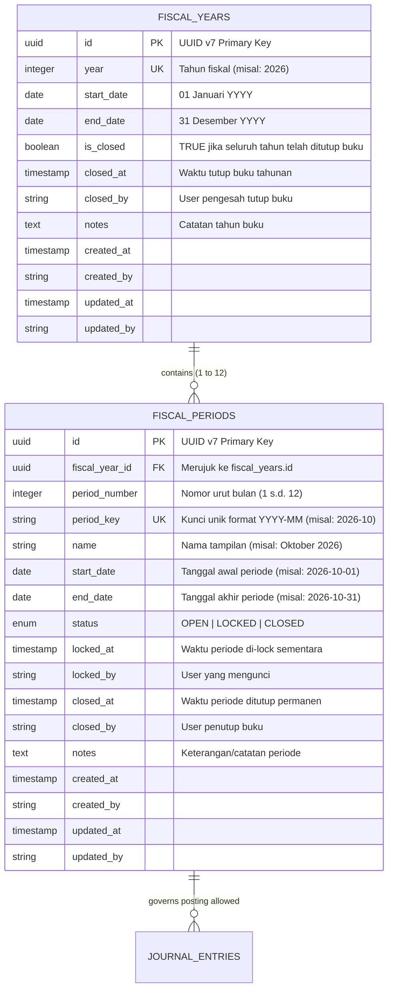
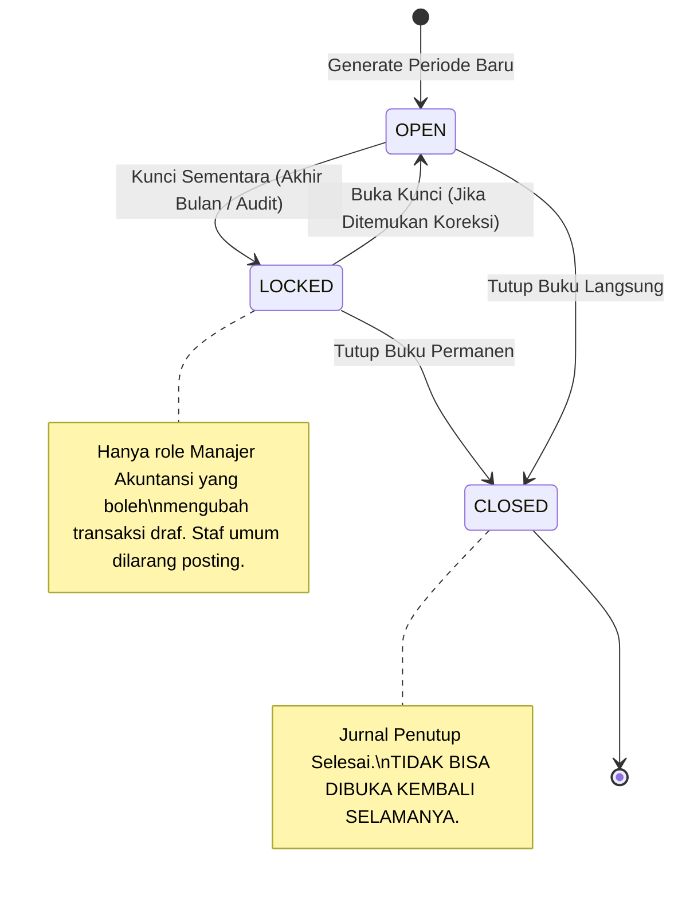

# Product Requirement Document (PRD): Fiscal Period & Accounting Calendar Domain

## 1. Ringkasan Eksekutif & Tujuan

Sub-modul `internal/accounting/fiscalperiod` bertindak sebagai **pengendali kalender akuntansi dan otoritas penutupan buku (*fiscal calendar & period closing control*)** di HOSIM-GO. Domain ini mengelola struktur tahun buku (*fiscal year*), pembagian periode bulanan (*accounting periods*), pengendalian hak akses pembukuan (*soft lock*), serta eksekusi tutup buku permanen (*hard close*).

PRD ini dirancang untuk menjamin **kepatuhan audit, pencegahan manipulasi tanggal (*anti-backdating fraud*), dan tata kelola pelaporan keuangan rumah sakit**:

1. **Struktur Berjenjang Tahun & Bulan (*Fiscal Year & Monthly Periods*)**: Mendukung pengelolaan tahun takwim (1 Januari – 31 Desember) yang otomatis dipecah menjadi 12 periode bulanan terstruktur (`YYYY-MM`).
2. **Pengendalian Status Tiga Tahap (`OPEN`, `LOCKED`, `CLOSED`)**:
   - `OPEN`: Masa aktif pencatatan transaksi harian.
   - `LOCKED`: Kunci sementara (*soft-lock*) saat tim akuntansi melakukan rekonsiliasi kas-bank dan penyesuaian akhir bulan. Staf operasional/kasir dilarang posting transaksi baru.
   - `CLOSED`: Kunci permanen (*hard-close*) setelah laporan keuangan disahkan. Tidak boleh ada mutasi jurnal baru selamanya pada periode ini.
3. **Penyekat Transaksi Otomatis (*Transaction Date Guard*)**: Menyediakan *guard service* bagi modul jurnal ([`internal/accounting/journal`](../journal/PRD.md)) untuk memvalidasi tanggal transaksi secara otomatis tanpa campur tangan manual pengguna.
4. **Otomasi Pembuatan Kalender (*Calendar Auto-Generation*)**: Menyediakan kapabilitas pembuatan satu tahun kalender fiskal beserta 12 periode bulanannya secara instan dan bebas konflik tanggal.

---

## 2. Arsitektur Data & Model Relasional

Kalender akuntansi disusun secara hierarki: satu tahun fiskal memiliki 12 (atau 13) periode akuntansi bulanan.



---

## 3. Spesifikasi Kolom Basis Data

### 3.1 Tabel `fiscal_years` (Tahun Buku)

| Kolom | Tipe Data | Constraint | Penjelasan |
|---|---|---|---|
| `id` | `VARCHAR(36)` | Primary Key | UUID v7 |
| `year` | `INTEGER` | Not Null, Unique | Tahun kalender (misal: `2026`) |
| `start_date` | `DATE` | Not Null | Tanggal awal tahun fiskal (biasanya `YYYY-01-01`) |
| `end_date` | `DATE` | Not Null | Tanggal akhir tahun fiskal (biasanya `YYYY-12-31`) |
| `is_closed` | `BOOLEAN` | Not Null, Default false | Status tutup buku tahunan |
| `closed_at` | `TIMESTAMPTZ` | Nullable | Jejak waktu tutup buku tahunan |
| `closed_by` | `VARCHAR(50)` | Nullable | Otorisator tutup buku tahunan |
| `notes` | `TEXT` | Nullable | Catatan/kebijakan akuntansi tahun tersebut |
| `created_at` | `TIMESTAMPTZ` | Not Null, Default CURRENT_TIMESTAMP | Jejak waktu pembuatan |
| `created_by` | `VARCHAR(50)` | Not Null, Default 'SYSTEM' | User pembuat |
| `updated_at` | `TIMESTAMPTZ` | Not Null, Default CURRENT_TIMESTAMP | Jejak waktu modifikasi |
| `updated_by` | `VARCHAR(50)` | Not Null, Default 'SYSTEM' | User pengubah |

---

### 3.2 Tabel `fiscal_periods` (Periode Bulanan)

| Kolom | Tipe Data | Constraint | Penjelasan |
|---|---|---|---|
| `id` | `VARCHAR(36)` | Primary Key | UUID v7 |
| `fiscal_year_id` | `VARCHAR(36)` | Not Null, FK `fiscal_years.id` | Merujuk ke induk tahun fiskal |
| `period_number` | `INTEGER` | Not Null | Urutan bulan (1 = Januari, 12 = Desember) |
| `period_key` | `VARCHAR(7)` | Not Null, Unique | Kunci unik baku format `YYYY-MM` (misal: `2026-10`) |
| `name` | `VARCHAR(100)` | Not Null | Nama deskriptif (misal: "Oktober 2026") |
| `start_date` | `DATE` | Not Null | Tanggal awal bulan (misal: `2026-10-01`) |
| `end_date` | `DATE` | Not Null | Tanggal akhir bulan (misal: `2026-10-31`) |
| `status` | `VARCHAR(20)` | Not Null, Default 'OPEN' | `OPEN`, `LOCKED`, atau `CLOSED` |
| `locked_at` | `TIMESTAMPTZ` | Nullable | Waktu penguncian sementara |
| `locked_by` | `VARCHAR(50)` | Nullable | User pengunci sementara |
| `closed_at` | `TIMESTAMPTZ` | Nullable | Waktu penutupan permanen |
| `closed_by` | `VARCHAR(50)` | Nullable | User penutup buku |
| `notes` | `TEXT` | Nullable | Keterangan status periode |
| `created_at` | `TIMESTAMPTZ` | Not Null, Default CURRENT_TIMESTAMP | Jejak waktu pembuatan |
| `created_by` | `VARCHAR(50)` | Not Null, Default 'SYSTEM' | User pembuat |
| `updated_at` | `TIMESTAMPTZ` | Not Null, Default CURRENT_TIMESTAMP | Jejak waktu modifikasi |
| `updated_by` | `VARCHAR(50)` | Not Null, Default 'SYSTEM' | User pengubah |

---

### 3.3 Indeks & Integritas Basis Data (PostgreSQL)

```sql
-- Indeks keunikan
CREATE UNIQUE INDEX idx_fiscal_years_year ON fiscal_years(year);
CREATE UNIQUE INDEX idx_fiscal_periods_period_key ON fiscal_periods(period_key);

-- Indeks kueri tanggal & status
CREATE INDEX idx_fiscal_periods_dates ON fiscal_periods(start_date, end_date);
CREATE INDEX idx_fiscal_periods_status ON fiscal_periods(status);
CREATE INDEX idx_fiscal_periods_year_id ON fiscal_periods(fiscal_year_id);

-- Check constraints
ALTER TABLE fiscal_periods ADD CONSTRAINT chk_fiscal_periods_status 
    CHECK (status IN ('OPEN', 'LOCKED', 'CLOSED'));

ALTER TABLE fiscal_periods ADD CONSTRAINT chk_fiscal_periods_number 
    CHECK (period_number BETWEEN 1 AND 13);

ALTER TABLE fiscal_periods ADD CONSTRAINT chk_fiscal_periods_date_range 
    CHECK (start_date <= end_date);

ALTER TABLE fiscal_years ADD CONSTRAINT chk_fiscal_years_date_range 
    CHECK (start_date <= end_date);
```

---

## 4. Invariant & Aturan Bisnis (Non-Negotiable)

### 4.1 Aturan Siklus Status Periode (*State Machine Rules*)



1. **Periode `OPEN`:**
   - Semua transaksi valid bertanggal dalam rentang `start_date` hingga `end_date` diizinkan untuk disimpan dan diposting.
2. **Periode `LOCKED` (Kunci Sementara):**
   - Transaksi baru dari modul operasional (*Billing*, *Kasir*, *Farmasi*) **DITOLAK**.
   - Hanya staf dengan hak akses khusus (`accounting:period:override`) yang dapat membuat jurnal penyesuaian (*adjusting entries*).
   - Periode `LOCKED` dapat dibuka kembali menjadi `OPEN` jika manajer akuntansi memberikan persetujuan.
3. **Periode `CLOSED` (Tutup Buku Permanen):**
   - Periode yang berstatus `CLOSED` bersifat **mutlak terkunci selamanya**.
   - Tidak ada seorang pun (termasuk Super Administrator) yang boleh memposting, mengedit, atau membatalkan jurnal pada tanggal yang masuk periode `CLOSED`.
   - Sebuah tahun fiskal (`fiscal_years`) hanya dapat diset `is_closed = true` jika **seluruh 12 periode bulanan di dalamnya sudah berstatus `CLOSED`**.

---

### 4.2 Larangan Penumpukan Tanggal (*No Date Overlapping*)
1. Tanggal mulai (`start_date`) dan tanggal selesai (`end_date`) pada periode bulanan tidak boleh tumpang tindih (*overlap*) dengan periode lain.
2. Setiap hari dalam tahun kalender harus tepat berada dalam **satu dan hanya satu** `fiscal_period`.

---

### 4.3 Resolusi Tanggal Otomatis ke Periode (*Date Resolution Invariant*)
1. Modul pencatatan jurnal tidak menerima input periode buku dari pengguna secara manual.
2. Sistem wajib mengekstrak tanggal transaksi (`entry_date`), lalu mencocokkannya ke database:
   ```sql
   SELECT id, period_key, status 
   FROM fiscal_periods 
   WHERE :entry_date BETWEEN start_date AND end_date;
   ```
3. Jika tanggal transaksi jatuh pada periode yang tidak ditemukan (belum dibuat kalendernya), sistem menolak transaksi dengan kode error `ERR_FISCAL_PERIOD_NOT_FOUND`.
4. Jika tanggal transaksi jatuh pada periode `LOCKED` atau `CLOSED`, sistem menolak transaksi dengan kode error `ERR_FISCAL_PERIOD_LOCKED` atau `ERR_FISCAL_PERIOD_CLOSED`.

---

## 5. Desain Endpoint REST API

Semua rute berada di bawah prefix `/api/v1/accounting/fiscal-periods` dan diotorisasi menggunakan RBAC middleware.

### 5.1 Daftar Endpoint

| Method | Endpoint | Permission | Penjelasan |
|---|---|---|---|
| `GET` | `/api/v1/accounting/fiscal-years` | `accounting:period:read` | List seluruh tahun fiskal beserta ringkasan status 12 bulannya |
| `POST` | `/api/v1/accounting/fiscal-years` | `accounting:period:manage` | Buat tahun fiskal baru (otomatis men-generate 12 bulan) |
| `GET` | `/api/v1/accounting/fiscal-periods` | `accounting:period:read` | List periode bulanan dengan filter tahun dan status |
| `GET` | `/api/v1/accounting/fiscal-periods/current` | `accounting:period:read` | Mengambil periode fiskal yang aktif untuk hari ini |
| `PUT` | `/api/v1/accounting/fiscal-periods/:id/lock` | `accounting:period:manage` | Mengunci sementara periode bulanan (`LOCKED`) |
| `PUT` | `/api/v1/accounting/fiscal-periods/:id/unlock` | `accounting:period:manage` | Membuka kembali periode yang terkunci (`LOCKED -> OPEN`) |
| `PUT` | `/api/v1/accounting/fiscal-periods/:id/close` | `accounting:period:close` | Menutup buku permanen periode bulanan (`CLOSED`) |
| `PUT` | `/api/v1/accounting/fiscal-years/:id/close` | `accounting:period:close` | Tutup buku akhir tahun fiskal (setelah 12 bulan closed) |

---

### 5.2 Contoh Kontrak Request & Response

#### Request: Buat Tahun Fiskal Baru (`POST /api/v1/accounting/fiscal-years`)
```json
{
  "year": 2026,
  "notes": "Tahun Buku Anggaran RS 2026"
}
```

#### Response Sukses (`201 Created`):
```json
{
  "success": true,
  "message": "Tahun fiskal 2026 beserta 12 periode bulanan berhasil dibuat",
  "data": {
    "id": "0192a600-0000-7000-aaaa-000000002026",
    "year": 2026,
    "start_date": "2026-01-01",
    "end_date": "2026-12-31",
    "is_closed": false,
    "periods_count": 12,
    "periods": [
      { "period_number": 1, "period_key": "2026-01", "name": "Januari 2026", "start_date": "2026-01-01", "end_date": "2026-01-31", "status": "OPEN" },
      { "period_number": 2, "period_key": "2026-02", "name": "Februari 2026", "start_date": "2026-02-01", "end_date": "2026-02-28", "status": "OPEN" },
      { "period_number": 10, "period_key": "2026-10", "name": "Oktober 2026", "start_date": "2026-10-01", "end_date": "2026-10-31", "status": "OPEN" },
      { "period_number": 12, "period_key": "2026-12", "name": "Desember 2026", "start_date": "2026-12-01", "end_date": "2026-12-31", "status": "OPEN" }
    ]
  }
}
```

---

## 6. Service Port Internal: `FiscalPeriodGuard`

Untuk dikonsumsi oleh modul [`internal/accounting/journal`](../journal/PRD.md):

```go
package fiscalperiod

import (
	"context"
	"time"
)

type ActivePeriodInfo struct {
	PeriodID   string
	PeriodKey  string // "2026-10"
	Status     string // "OPEN", "LOCKED", "CLOSED"
}

// FiscalPeriodGuard adalah port yang diekspos untuk memvalidasi tanggal transaksi
type FiscalPeriodGuard interface {
	// ValidateDateForPosting memverifikasi bahwa tanggal berada di periode OPEN
	ValidateDateForPosting(ctx context.Context, entryDate time.Time) (*ActivePeriodInfo, error)
}
```
