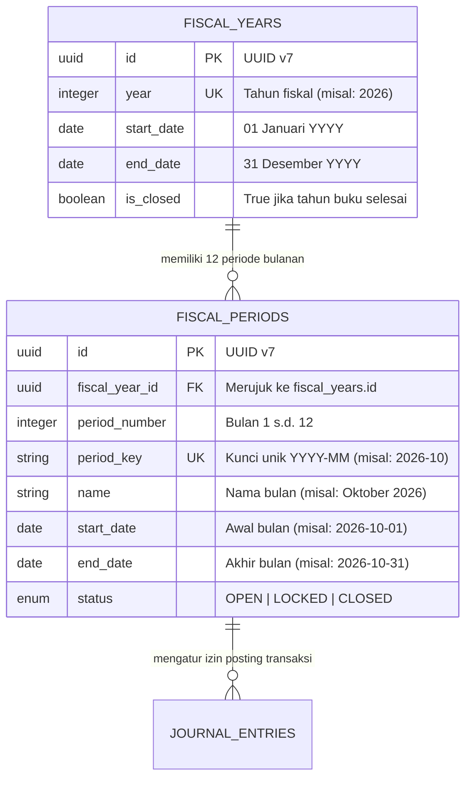
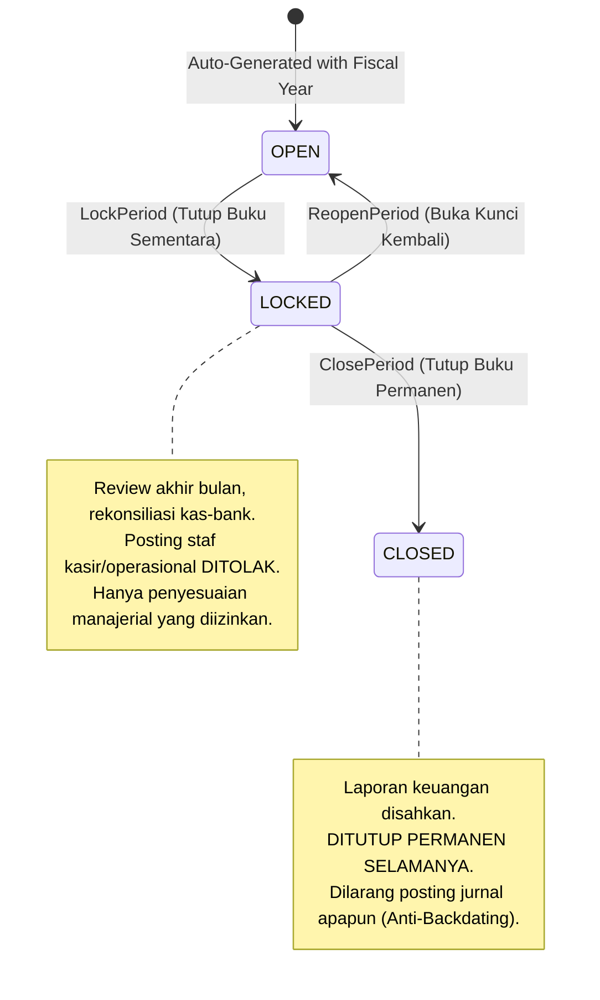

# Dokumentasi & Panduan Modul Periode Fiskal (`internal/accounting/fiscalperiod`)

Dokumen ini merupakan panduan komprehensif mengenai arsitektur, siklus penutupan buku (*period closing control*), aturan integritas kalender akuntansi, serta mekanisme guard antarmuka (*outbound port*) bagi kontributor pengembang dan *coding AI agents* pada modul **Kalender Fiskal & Periode Pembukuan** di sistem **HOSIM-GO**.

---

## 1. Ikhtisar & Tujuan Domain

Modul `internal/accounting/fiscalperiod` bertindak sebagai **pengendali kalender akuntansi dan otoritas penutupan buku (*fiscal calendar & period closing control*)** di HOSIM-GO. Domain ini mengelola struktur tahun buku (*fiscal year*), pembagian periode bulanan (*accounting periods*), pengendalian hak akses pembukuan (*soft lock*), serta eksekusi tutup buku permanen (*hard close*).

Sesuai aturan [AGENTS.md](../../../AGENTS.md), modul ini dirancang untuk menjamin:
- **Pencegahan Manipulasi Tanggal (*Anti-Backdating Fraud*)**: Mencegah pencatatan transaksi susulan pada bulan atau tahun buku yang telah ditutup dan disahkan oleh auditor/manajemen rumah sakit.
- **Guard Antarmuka Otomatis (*FiscalPeriodGuard*)**: Menyediakan outbound port [`FiscalPeriodGuard`](ports.go#L18) bagi modul jurnal ([`internal/accounting/journal`](../journal)) dan modul pelayanan (Kasir, Billing, Farmasi) untuk memvalidasi kelayakan tanggal transaksi secara otomatis.
- **Otomasi Kalender Akuntansi**: Mampu menghasilkan 12 periode bulanan terstruktur secara instan lengkap dengan penanganan tahun kabisat (*leap year*).

---

## 2. Proses Bisnis & Invariant Kalender Akuntansi

### 2.1 Model Relasional Berjenjang (Tahun & Bulan)



---

### 2.2 Siklus Hidup Status Periode (*3-State Period Lifecycle*)

Setiap periode bulanan (`fiscal_periods`) memiliki transisi status terkontrol:



1. **Status `OPEN` (Periode Aktif)**:
   - Periode terbuka untuk menerima posting transaksi rutin harian dari kasir, billing, farmasi, maupun jurnal umum akuntansi.
2. **Status `LOCKED` (Kunci Sementara / Soft Lock)**:
   - Diaktifkan saat tim akuntansi mulai melakukan rekonsiliasi akhir bulan (rekonsiliasi bank, opname stok farmasi, jurnal penyesuaian beban akrual/depresiasi).
   - Seluruh transaksi operasional baru **DITOLAK**.
   - Hanya akuntan dengan hak akses otorisasi penyesuaian manajerial (`accounting:period:override`) yang boleh melakukan posting jurnal penyesuaian (*Adjustment*).
   - Dapat dibuka kembali ke status `OPEN` (`ReopenPeriod`) jika ditemukan transaksi operasional yang tertinggal.
3. **Status `CLOSED` (Tutup Buku Permanen / Hard Close)**:
   - Diaktifkan setelah laporan audit keuangan bulanan selesai dan ditandatangani direksi/auditor.
   - **Terkunci Permanen**: Periode berstatus `CLOSED` **HARAM DIBUKA KEMBALI** dan **DITOLAK KERAS** dari segala bentuk mutasi jurnal selamanya (`ErrPeriodClosed`).

---

### 2.3 Aturan Invariant Tutup Buku Tahunan (*Year Closing Invariant*)

Tahun fiskal (`fiscal_years`) hanya dapat ditutup (`CloseFiscalYear`) jika **seluruh 12 periode bulanan di dalamnya telah berstatus `CLOSED`**. Hal ini mencegah penutupan tahun buku secara prematur saat masih ada bulan yang berstatus `OPEN` atau `LOCKED`.

---

## 3. Integrasi Antarmuka (Outbound Port: `FiscalPeriodGuard`)

Modul ini mengekspor antarmuka port [ports.go](ports.go#L18) untuk digunakan oleh modul lain:

```go
type FiscalPeriodGuard interface {
    ValidateDateForPosting(ctx context.Context, entryDate time.Time) (*ActivePeriodInfo, error)
}
```

### 3.1 Cara Modul Lain Memanfaatkan `FiscalPeriodGuard`

Ketika modul Jurnal atau Billing menerima transaksi, caller cukup memanggil `ValidateDateForPosting`:

```go
func (s *journalService) CreateDraft(ctx context.Context, req CreateJournalRequest, actor string) (*JournalResponse, error) {
    entryDate, _ := time.Parse("2006-01-02", req.EntryDate)

    // Validasi apakah tanggal transaksi diizinkan untuk pembukuan
    periodInfo, err := s.fiscalPeriodGuard.ValidateDateForPosting(ctx, entryDate)
    if err != nil {
        // Otomatis menolak jika tanggal berada di bulan LOCKED atau CLOSED
        return nil, err
    }

    // Gunakan periodInfo.PeriodID dan periodInfo.PeriodKey ("2026-10")
    ...
}
```

### 3.2 Error Sentinel yang Dihasilkan

| Error Sentinel | Keterangan | Tindakan Penanganan |
|---|---|---|
| `ErrPeriodNotFound` | Tanggal transaksi berada di luar seluruh kalender fiskal yang terdaftar. | Buat tahun kalender baru via API Fiscal Year. |
| `ErrPeriodLocked` | Periode sedang dikunci sementara untuk tutup buku bulanan. | Minta staf akuntansi membuka kunci sementara jika transaksi mendesak. |
| `ErrPeriodClosed` | Periode telah ditutup permanen. | Backdating ditolak keras. Transaksi harus dialihkan ke periode yang masih `OPEN`. |
| `ErrYearAlreadyClosed` | Tahun fiskal telah ditutup buku tahunan. | Tidak dapat memanipulasi tahun buku yang sudah diaudit. |

---

## 4. Skema Basis Data (PostgreSQL)

Didefinisikan pada migration file [`migrations/00017_create_fiscal_periods_tables.sql`](../../../migrations/00017_create_fiscal_periods_tables.sql):

### 4.1 Tabel `fiscal_years` (Tahun Buku)

| Kolom | Tipe Data | Constraint | Keterangan |
|---|---|---|---|
| `id` | `VARCHAR(36)` | Primary Key | UUID v7 |
| `year` | `INTEGER` | Not Null, Unique | Angka tahun kalender (misal: `2026`) |
| `start_date` | `DATE` | Not Null | `YYYY-01-01` |
| `end_date` | `DATE` | Not Null | `YYYY-12-31` |
| `is_closed` | `BOOLEAN` | Not Null, Default false | Status tutup buku tahunan |
| `closed_at`, `closed_by` | `TIMESTAMPTZ`, `VARCHAR(50)` | Nullable | Jejak audit penutupan tahunan |
| `notes` | `TEXT` | Nullable | Catatan kebijakan akuntansi |

### 4.2 Tabel `fiscal_periods` (Bulan Pembukuan)

| Kolom | Tipe Data | Constraint | Keterangan |
|---|---|---|---|
| `id` | `VARCHAR(36)` | Primary Key | UUID v7 |
| `fiscal_year_id` | `VARCHAR(36)` | Not Null, FK `fiscal_years` | Relasi ke induk tahun buku (`CASCADE`) |
| `period_number` | `INTEGER` | Not Null | Urutan bulan (1 s.d. 12) |
| `period_key` | `VARCHAR(7)` | Not Null, Unique | Format standar `YYYY-MM` (misal: `2026-10`) |
| `name` | `VARCHAR(100)` | Not Null | Deskripsi bulan (misal: "Oktober 2026") |
| `start_date` | `DATE` | Not Null | Awal bulan |
| `end_date` | `DATE` | Not Null | Akhir bulan (menghitung tahun kabisat 29 Feb otomatis) |
| `status` | `VARCHAR(20)` | Not Null, Default 'OPEN' | `OPEN`, `LOCKED`, atau `CLOSED` |
| `locked_at`, `locked_by` | `TIMESTAMPTZ`, `VARCHAR(50)` | Nullable | Jejak audit kunci sementara |
| `closed_at`, `closed_by` | `TIMESTAMPTZ`, `VARCHAR(50)` | Nullable | Jejak audit tutup buku permanen |

---

## 5. Daftar Endpoint REST API

Koleksi pengujian Bruno lengkap tersedia di [`bruno/Accounting/FiscalPeriods/`](../../../bruno/Accounting/FiscalPeriods):

| Method | Endpoint | Hak Akses (RBAC) | Deskripsi |
|---|---|---|---|
| `POST` | `/api/v1/accounting/fiscal-years` | `accounting:fiscalperiod:write` | Mendaftarkan tahun fiskal baru (otomatis membuat 12 bulan) |
| `GET` | `/api/v1/accounting/fiscal-years` | `accounting:fiscalperiod:read` | Menampilkan seluruh tahun fiskal |
| `GET` | `/api/v1/accounting/fiscal-years/:id` | `accounting:fiscalperiod:read` | Menampilkan rincian tahun fiskal dan 12 bulannya |
| `POST` | `/api/v1/accounting/fiscal-years/:id/close` | `accounting:fiscalperiod:write` | Menutup buku tahunan (wajib seluruh 12 bulan `CLOSED`) |
| `GET` | `/api/v1/accounting/fiscal-periods` | `accounting:fiscalperiod:read` | Menampilkan daftar seluruh periode bulanan |
| `GET` | `/api/v1/accounting/fiscal-periods/:id` | `accounting:fiscalperiod:read` | Menampilkan detail periode bulanan |
| `POST` | `/api/v1/accounting/fiscal-periods/:id/lock` | `accounting:fiscalperiod:write` | Mengunci sementara periode bulanan (`LOCKED`) |
| `POST` | `/api/v1/accounting/fiscal-periods/:id/reopen` | `accounting:fiscalperiod:write` | Membuka kembali periode yang di-lock (`OPEN`) |
| `POST` | `/api/v1/accounting/fiscal-periods/:id/close` | `accounting:fiscalperiod:write` | Menutup permanen periode bulanan (`CLOSED`) |

---

## 6. Pengujian & Verifikasi

```powershell
# Jalankan test khusus modul fiscal period
go test -v ./internal/accounting/fiscalperiod/...

# Jalankan seluruh test suite
go test ./...
```
