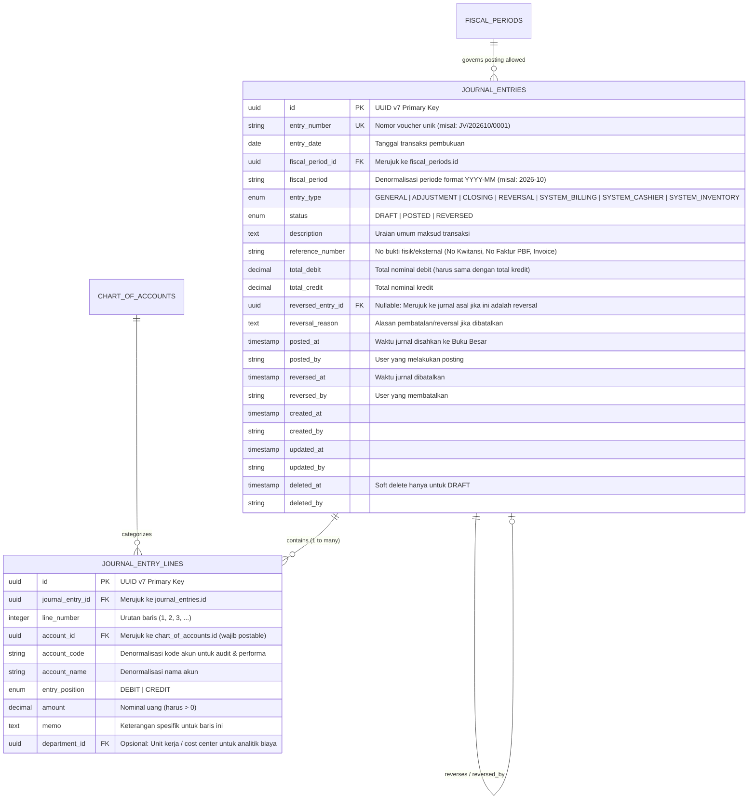
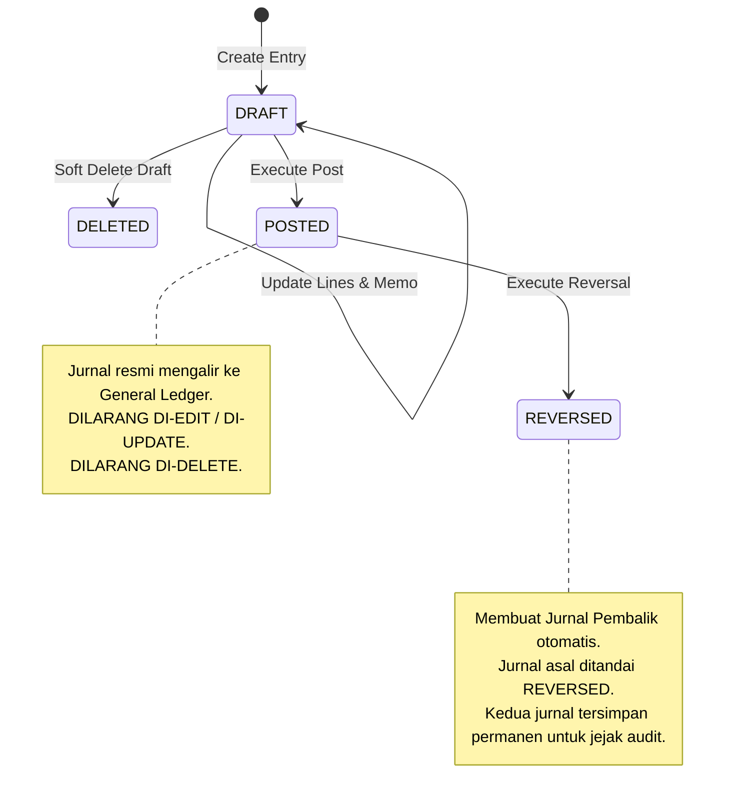

# Product Requirement Document (PRD): Journal Entries & General Ledger Engine

## 1. Ringkasan Eksekutif & Tujuan

Sub-modul `internal/accounting/journal` adalah **mesin pencatatan transaksi finansial utama (*core double-entry bookkeeping engine*)** di HOSIM-GO. Modul ini bertanggung jawab atas pencatatan, validasi, pengesahan (*posting*), dan pembatalan (*reversal*) seluruh mutasi keuangan rumah sakit—baik yang diinput manual oleh staf akuntansi maupun yang dipicu otomatis oleh modul operasional (*Billing Pasien*, *Kasir*, *Farmasi*, *Logistik*, dan *Penggajian*).

PRD ini dirancang dengan prinsip **kepatuhan audit tinggi, zero-tolerance selisih finansial, dan keterpisahan tanggung jawab (Clean Architecture)**:

1. **Prinsip Pembukuan Berpasangan (*Double-Entry Balancing*)**: Menjamin bahwa setiap transaksi yang masuk wajib memiliki total Debit dan Kredit yang sama persis ($\sum Debit = \sum Credit$).
2. **Integritas Permanen (*Immutability & Audit Trail*)**: Jurnal yang telah berstatus `POSTED` **haram diedit atau dihapus**. Perbaikan kesalahan transaksi hanya sah dilakukan melalui mekanisme **Jurnal Pembalik (*Reversal / Storno Entry*)**.
3. **Penyaringan Akun Daun (*Postable Account Guard*)**: Menjamin transaksi hanya boleh menggunakan akun detail level terbawah ([`chart_of_accounts`](../account/PRD.md)) dengan status `is_postable = true` dan `is_active = true`. Akun induk dilarang keras dijurnal.
4. **Pertahanan Tiga Lapis (*3-Ring Defense-in-Depth*)**:
   - *Ring 1 (Domain)*: Pemeriksaan keseimbangan debit-kredit voucher di memori aplikasi sebelum eksekusi.
   - *Ring 2 (Database Atomicity)*: Penyimpanan voucher dan seluruh baris rincian dalam satu transaksi atomik PostgreSQL (`BEGIN ... COMMIT`).
   - *Ring 3 (Trial Balance Sanity Check)*: Verifikasi akhir sebelum commit bahwa total akumulasi debit dan kredit di seluruh sistem tetap berimbang tanpa ada selisih ($\Delta = 0$).
5. **Pintu Integrasi Modul Eksternal (*System Auto-Journal Port*)**: Menyediakan kontrak interface Go yang stabil bagi modul *Billing*, *Kasir*, dan *Farmasi* untuk memposting transaksi otomatis tanpa melanggar batasan modul (*module boundary*).

---

## 2. Arsitektur Data & Model Relasional

Pencatatan jurnal menggunakan struktur induk-rincian (*header-lines*) yang terhubung langsung ke bagan akun (*Chart of Accounts*).



---

## 3. Spesifikasi Kolom Basis Data

### 3.1 Tabel `journal_entries` (Header Jurnal)

| Kolom | Tipe Data | Constraint | Penjelasan |
|---|---|---|---|
| `id` | `VARCHAR(36)` | Primary Key | UUID v7 |
| `entry_number` | `VARCHAR(50)` | Not Null, Unique | Nomor voucher terstruktur (misal: `JV/202610/0001`) |
| `entry_date` | `DATE` | Not Null | Tanggal transaksi diakui secara akuntansi |
| `fiscal_period_id` | `VARCHAR(36)` | Not Null, FK `fiscal_periods.id` | Periode buku kalender fiskal |
| `fiscal_period` | `VARCHAR(7)` | Not Null | Salinan `period_key` (format `YYYY-MM`, misal: `2026-10`) |
| `entry_type` | `VARCHAR(30)` | Not Null | Klasifikasi asal transaksi (lihat daftar enum) |
| `status` | `VARCHAR(20)` | Not Null, Default 'DRAFT' | `DRAFT`, `POSTED`, atau `REVERSED` |
| `description` | `TEXT` | Not Null | Catatan ringkas uraian transaksi |
| `reference_number` | `VARCHAR(100)` | Nullable | Nomor referensi dokumen fisik (kuitansi, invoice vendor, klaim) |
| `total_debit` | `NUMERIC(18,2)` | Not Null, Default 0 | Total penjumlahan baris debit |
| `total_credit` | `NUMERIC(18,2)` | Not Null, Default 0 | Total penjumlahan baris kredit |
| `reversed_entry_id`| `VARCHAR(36)` | Nullable, FK | Merujuk ke `journal_entries.id` jika voucher ini adalah jurnal pembalik |
| `reversal_reason` | `TEXT` | Nullable | Justifikasi pembatalan |
| `posted_at` | `TIMESTAMPTZ` | Nullable | Waktu resmi posting ke Buku Besar |
| `posted_by` | `VARCHAR(50)` | Nullable | Username/ID staf pengesah posting |
| `reversed_at` | `TIMESTAMPTZ` | Nullable | Waktu resmi reversal dieksekusi |
| `reversed_by` | `VARCHAR(50)` | Nullable | Username/ID staf pembatal |
| `created_at` | `TIMESTAMPTZ` | Not Null, Default CURRENT_TIMESTAMP | Jejak waktu pembuatan |
| `created_by` | `VARCHAR(50)` | Not Null, Default 'SYSTEM' | User pembuat |
| `updated_at` | `TIMESTAMPTZ` | Not Null, Default CURRENT_TIMESTAMP | Jejak waktu modifikasi draf |
| `updated_by` | `VARCHAR(50)` | Not Null, Default 'SYSTEM' | User pengubah draf |
| `deleted_at` | `TIMESTAMPTZ` | Nullable | Soft delete (hanya berlaku untuk DRAFT) |
| `deleted_by` | `VARCHAR(50)` | Nullable | User penghapus draf |

### 3.2 Tabel `journal_entry_lines` (Rincian Baris Jurnal)

| Kolom | Tipe Data | Constraint | Penjelasan |
|---|---|---|---|
| `id` | `VARCHAR(36)` | Primary Key | UUID v7 |
| `journal_entry_id` | `VARCHAR(36)` | Not Null, FK `journal_entries.id` | Induk voucher jurnal |
| `line_number` | `INTEGER` | Not Null | Urutan baris tampilan (1, 2, 3...) |
| `account_id` | `VARCHAR(36)` | Not Null, FK `chart_of_accounts.id` | Akun COA yang dipengaruhi (wajib `is_postable = true`) |
| `account_code` | `VARCHAR(50)` | Not Null | Salinan kode akun saat transaksi dibuat |
| `account_name` | `VARCHAR(150)` | Not Null | Salinan nama akun saat transaksi dibuat |
| `entry_position` | `VARCHAR(10)` | Not Null | `DEBIT` atau `CREDIT` |
| `amount` | `NUMERIC(18,2)` | Not Null | Nilai transaksi (harus $> 0$) |
| `memo` | `TEXT` | Nullable | Keterangan spesifik untuk akun baris ini |
| `department_id` | `VARCHAR(36)` | Nullable | Departemen/unit kerja RS untuk alokasi akuntansi biaya |

---

### 3.3 Indeks & Integritas Basis Data (PostgreSQL)

```sql
-- Indeks keunikan voucher
CREATE UNIQUE INDEX idx_journal_entries_entry_number ON journal_entries(entry_number) WHERE deleted_at IS NULL;

-- Indeks pencarian & buku besar
CREATE INDEX idx_journal_entries_date_status ON journal_entries(entry_date, status);
CREATE INDEX idx_journal_entries_fiscal_period ON journal_entries(fiscal_period);
CREATE INDEX idx_journal_entries_entry_type ON journal_entries(entry_type);
CREATE INDEX idx_journal_entry_lines_entry_id ON journal_entry_lines(journal_entry_id);
CREATE INDEX idx_journal_entry_lines_account_id ON journal_entry_lines(account_id);

-- Check constraints integritas
ALTER TABLE journal_entries ADD CONSTRAINT chk_journal_entries_type 
    CHECK (entry_type IN ('GENERAL', 'ADJUSTMENT', 'CLOSING', 'REVERSAL', 'SYSTEM_BILLING', 'SYSTEM_CASHIER', 'SYSTEM_INVENTORY'));

ALTER TABLE journal_entries ADD CONSTRAINT chk_journal_entries_status 
    CHECK (status IN ('DRAFT', 'POSTED', 'REVERSED'));

ALTER TABLE journal_entries ADD CONSTRAINT chk_journal_entries_amounts 
    CHECK (total_debit >= 0 AND total_credit >= 0);

ALTER TABLE journal_entry_lines ADD CONSTRAINT chk_journal_lines_position 
    CHECK (entry_position IN ('DEBIT', 'CREDIT'));

ALTER TABLE journal_entry_lines ADD CONSTRAINT chk_journal_lines_amount 
    CHECK (amount > 0);
```

---

## 4. Invariant & Aturan Bisnis (Non-Negotiable)

### 4.1 Aturan Keseimbangan Debit & Kredit (*Double-Entry Balancing*)
1. Setiap voucher jurnal wajib memiliki **minimal 2 baris** rincian (1 Debit dan 1 Kredit).
2. Total nominal Debit harus sama persis dengan total nominal Kredit:
   $$\sum \text{Debit} - \sum \text{Credit} = 0$$
3. Jika terdapat selisih pembulatan sekecil apapun (misal Rp 0,01), sistem wajib menolak proses penyimpanan atau posting dengan kode kesalahan `ERR_JOURNAL_UNBALANCED`.

---

### 4.2 Validasi Kelayakan Akun (*Account Eligibility Guard*)
1. Akun yang dipilih pada `journal_entry_lines` wajib berstatus:
   - `is_active = true` (Akun aktif).
   - `is_postable = true` (Akun daun/detail, bukan header grup).
2. Jika sebuah akun header (misal `1000 - ASET LANCAR`) dicoba dimasukkan ke baris jurnal, sistem melempar error `ERR_ACCOUNT_NOT_POSTABLE`.

---

### 4.3 Validasi Periode Fiskal (*Fiscal Period Guard*)
1. Sistem secara otomatis mencocokkan `entry_date` ke kalender akuntansi melalui port [`fiscalperiod.FiscalPeriodGuard`](../fiscalperiod/PRD.md).
2. Transaksi hanya boleh dibuat atau diposting apabila periode yang memuat tanggal tersebut berstatus **`OPEN`**.
3. Jika periode berstatus **`LOCKED`**, posting transaksi ditolak kecuali dilakukan oleh pengguna dengan wewenang penyesuaian manajerial (`accounting:period:override`).
4. Jika periode berstatus **`CLOSED`**, transaksi **DITOLAK KERAS** secara permanen (`ERR_FISCAL_PERIOD_CLOSED`) untuk mencegah manipulasi data historis (*anti-backdating*).

---

### 4.4 Kebijakan Mutlak Status & Imutabilitas (*Immutability Policy*)



1. **Fase DRAFT:**
   - Draf jurnal boleh diedit berulang kali.
   - Draf jurnal boleh dihapus (*soft delete*).
   - Draf jurnal **TIDAK MEMPENGARUHI** saldo akun di Buku Besar maupun Laporan Keuangan.
2. **Fase POSTED:**
   - Pengesahan posting langsung memperbarui mutasi akun di Buku Besar (*General Ledger*).
   - Jurnal berstatus `POSTED` **HARAM DIUBAH** kolom apapun selain metadata audit.
   - Jurnal berstatus `POSTED` **DILARANG DIHAPUS** (*Forbidden Hard/Soft Delete*).
3. **Fase REVERSED:**
   - Jika terjadi kesalahan pada jurnal yang telah diposting, staf akuntansi harus menggunakan fitur **Reverse (Jurnal Pembalik)**.
   - Sistem akan membuat satu voucher baru bertipe `REVERSAL` yang berisi baris-baris berlawanan persis (Debit menjadi Kredit, Kredit menjadi Debit).
   - Jurnal asli diubah statusnya menjadi `REVERSED` dan mencatat `reversal_reason`.

---

### 4.5 Mekanisme Pertahanan Tiga Lapis (*3-Ring Defense-in-Depth*)

Untuk menjamin **0% toleransi selisih pada Neraca Saldo Rumah Sakit**, use case posting menerapkan:

1. **Lapis 1 (In-Memory Check):**
   Memeriksa bahwa entity voucher `TotalDebit == TotalCredit` sebelum membuka koneksi database.
2. **Lapis 2 (PostgreSQL Transactional Isolation):**
   Semua baris disimpan dalam transaksi `db.BeginTx(...)`. Jika satu baris gagal, seluruh voucher dibatalkan secara atomik.
3. **Lapis 3 (Global Sanity Check Sebelum Commit):**
   Sesaat sebelum mengeksekusi `tx.Commit()`, sistem menjalankan kueri verifikasi integritas:
   ```sql
   SELECT COALESCE(SUM(CASE WHEN entry_position = 'DEBIT' THEN amount ELSE -amount END), 0) AS system_discrepancy
   FROM journal_entry_lines jel
   JOIN journal_entries je ON je.id = jel.journal_entry_id
   WHERE je.status = 'POSTED' AND je.deleted_at IS NULL;
   ```
   Jika `system_discrepancy != 0`, transaksi **wajib di-ROLLBACK** seketika dan melempar critical alert: `ERR_TRIAL_BALANCE_CORRUPTED`.

---

### 4.6 Penomoran Voucher Otomatis (*Voucher Numbering Sequence*)

Format nomor voucher tersusun secara sistematis dan unik:
$$\text{KODE\_TIPE} / \text{YYYYMM} / \text{NOMOR\_URUT\_5\_DIGIT}$$

Contoh:
- Jurnal Umum Manual: `JV/202610/00001`
- Jurnal Billing Otomatis: `BIL/202610/00142`
- Jurnal Penerimaan Kasir: `CSH/202610/00089`
- Jurnal Pembalik: `REV/202610/00003`

Nomor urut dihasilkan secara atomik di database untuk mencegah duplikasi (*concurrency collision*).

---

## 5. Desain Endpoint REST API

Semua rute berada di bawah prefix `/api/v1/accounting/journals` dan diotorisasi menggunakan RBAC middleware.

### 5.1 Daftar Endpoint

| Method | Endpoint | Permission | Penjelasan |
|---|---|---|---|
| `GET` | `/api/v1/accounting/journals` | `accounting:journal:read` | List jurnal terpaginasi dengan filter: tanggal, tipe, status, pencarian nomor/uraian |
| `GET` | `/api/v1/accounting/journals/:id` | `accounting:journal:read` | Ambil detail lengkap satu voucher beserta seluruh barisnya |
| `POST` | `/api/v1/accounting/journals` | `accounting:journal:create` | Buat voucher jurnal draf baru (manual entry) |
| `PUT` | `/api/v1/accounting/journals/:id` | `accounting:journal:update` | Perbarui isi draf jurnal (hanya boleh jika status `DRAFT`) |
| `DELETE` | `/api/v1/accounting/journals/:id` | `accounting:journal:delete` | Hapus draf jurnal (hanya boleh jika status `DRAFT`) |
| `POST` | `/api/v1/accounting/journals/:id/post` | `accounting:journal:post` | Sahkan draf jurnal menjadi `POSTED` (mengalir ke Buku Besar) |
| `POST` | `/api/v1/accounting/journals/:id/reverse` | `accounting:journal:reverse` | Batalkan jurnal `POSTED` dengan menerbitkan voucher pembalik |

---

### 5.2 Contoh Payload Request & Response

#### Request: Buat Draf Jurnal Manual (`POST /api/v1/accounting/journals`)
```json
{
  "entry_date": "2026-10-19",
  "entry_type": "GENERAL",
  "description": "Pembayaran tagihan listrik & utilitas gedung rumah sakit bulan Oktober 2026",
  "reference_number": "PLN-OCT-2026-081",
  "lines": [
    {
      "account_id": "0192a000-0000-7000-0000-000000005120",
      "entry_position": "DEBIT",
      "amount": 35000000.00,
      "memo": "Tagihan listrik PLN gedung utama & rawat inap"
    },
    {
      "account_id": "0192a000-0000-7000-0000-000000001113",
      "entry_position": "CREDIT",
      "amount": 35000000.00,
      "memo": "Transfer via Bank Mandiri Operasional RS"
    }
  ]
}
```

#### Response Sukses (`201 Created`):
```json
{
  "success": true,
  "message": "Draf jurnal berhasil dibuat",
  "data": {
    "id": "0192a500-1111-7000-aaaa-000000000001",
    "entry_number": "JV/202610/00001",
    "entry_date": "2026-10-19",
    "fiscal_period": "2026-10",
    "entry_type": "GENERAL",
    "status": "DRAFT",
    "description": "Pembayaran tagihan listrik & utilitas gedung rumah sakit bulan Oktober 2026",
    "reference_number": "PLN-OCT-2026-081",
    "total_debit": 35000000.00,
    "total_credit": 35000000.00,
    "lines_count": 2,
    "lines": [
      {
        "id": "0192a500-1111-7000-bbbb-000000000001",
        "line_number": 1,
        "account_id": "0192a000-0000-7000-0000-000000005120",
        "account_code": "5120",
        "account_name": "Beban Listrik, Air & Utilitas",
        "entry_position": "DEBIT",
        "amount": 35000000.00,
        "memo": "Tagihan listrik PLN gedung utama & rawat inap"
      },
      {
        "id": "0192a500-1111-7000-bbbb-000000000002",
        "line_number": 2,
        "account_id": "0192a000-0000-7000-0000-000000001113",
        "account_code": "1113",
        "account_name": "Bank Mandiri Operasional",
        "entry_position": "CREDIT",
        "amount": 35000000.00,
        "memo": "Transfer via Bank Mandiri Operasional RS"
      }
    ],
    "created_at": "2026-10-19T10:00:00Z",
    "created_by": "user-akuntan-1"
  }
}
```

#### Request: Batalkan Jurnal / Reverse (`POST /api/v1/accounting/journals/:id/reverse`)
```json
{
  "reason": "Salah input nominal tarif pada transaksi pemeriksaan pasien poli, harus diulang"
}
```

---

## 6. Port Antar-Modul: Auto-Journaling Contract

Untuk kebutuhan modul **Billing**, **Kasir**, dan **Farmasi** di masa depan, modul `accounting` mengekspos Go interface resmi tanpa membocorkan model internal GORM:

```go
package journal

import (
	"context"
	"time"
)

type SystemJournalLine struct {
	AccountCode   string
	Position      string // "DEBIT" atau "CREDIT"
	Amount        float64
	Memo          string
	DepartmentID  *string
}

type PostSystemJournalCommand struct {
	EntryDate       time.Time
	EntryType       string // e.g., "SYSTEM_BILLING", "SYSTEM_CASHIER"
	Description     string
	ReferenceNumber string // e.g., No Tagihan Billing "BILL-202610-0091"
	Lines           []SystemJournalLine
	ActorID         string
}

// JournalPostingPort adalah port yang diimplementasikan oleh internal/accounting/journal
type JournalPostingPort interface {
	// PostSystemJournal membuat dan langsung mengesahkan (POSTED) jurnal dari transaksi otomatis modul lain
	PostSystemJournal(ctx context.Context, cmd PostSystemJournalCommand) (string, error)
}
```

Dengan kontrak ini, modul operasional rumah sakit di masa depan cukup memanggil `PostSystemJournal(...)`, dan mesin akuntansi akan menjamin validasi saldo normal, keseimbangan, serta pembukuan buku besar secara atomik.
