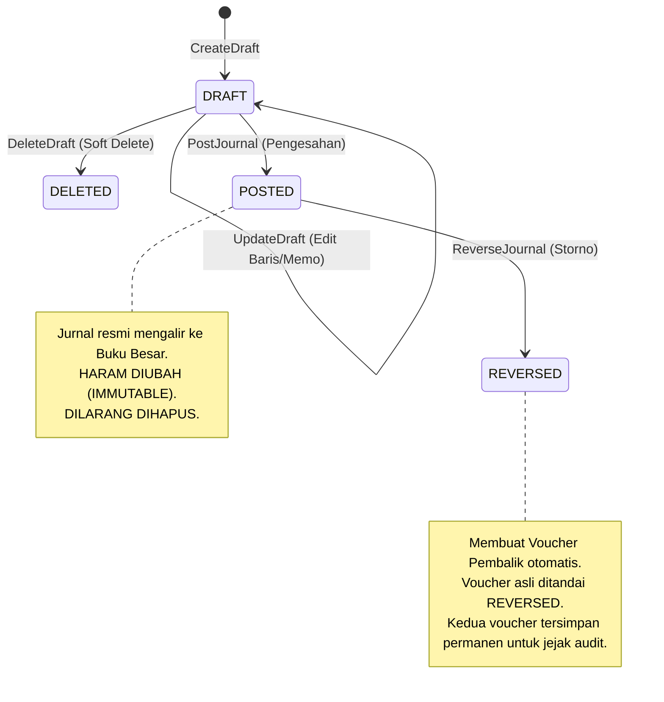
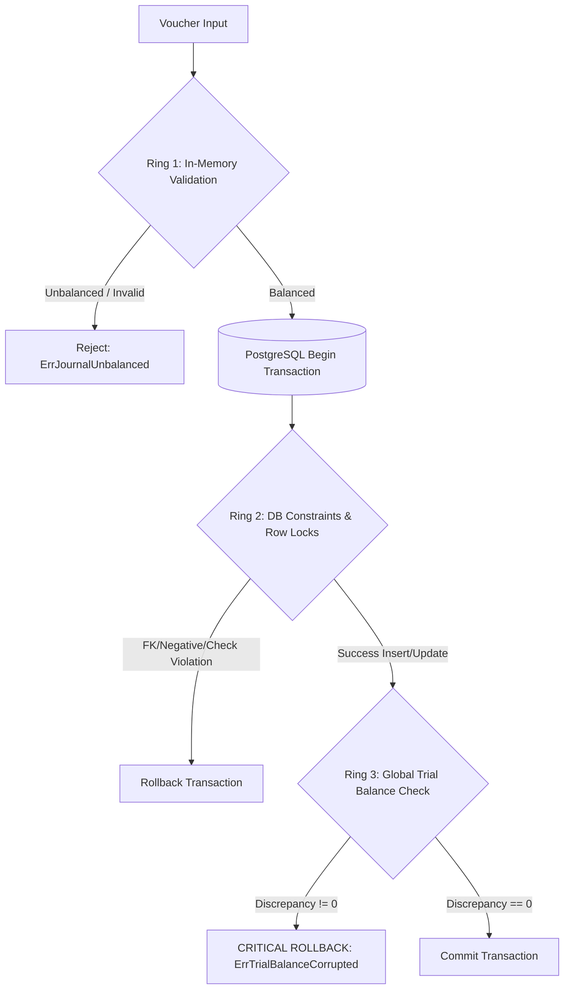
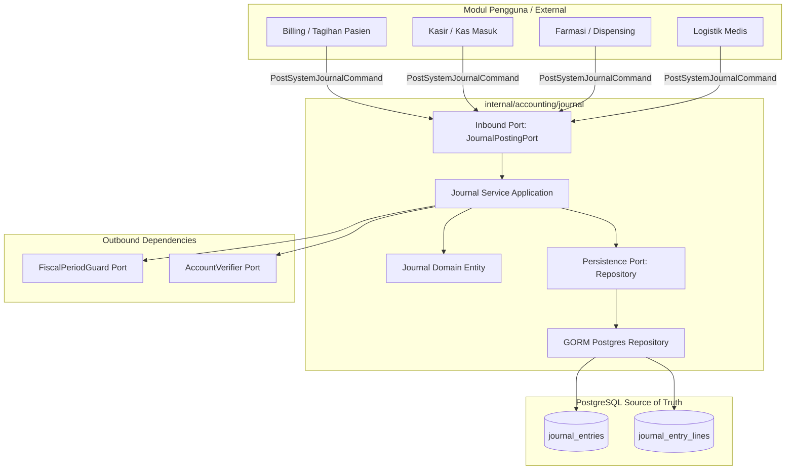

# Dokumentasi & Panduan Modul Jurnal Akuntansi (`internal/accounting/journal`)

Dokumen ini merupakan panduan komprehensif mengenai arsitektur, proses bisnis akuntansi, aturan integritas data, serta mekanisme integrasi (*porting*) bagi kontributor pengembang dan *coding AI agents* pada modul **Pencatatan Jurnal & Buku Besar (*General Ledger*)** di sistem **HOSIM-GO**.

---

## 1. Ikhtisar & Tujuan Domain

Modul `internal/accounting/journal` bertindak sebagai **jantung pencatatan transaksi keuangan rumah sakit**. Seluruh peristiwa bisnis yang memiliki dampak moneter—mulai dari penerimaan pembayaran kasir, piutang pelayanan pasien rawat jalan/inap, penggunaan persediaan farmasi/alkes, hingga penyesuaian manajerial akhir bulan—bermuara pada modul ini dalam bentuk **Voucher Jurnal Berpasangan (*Double-Entry Journal Entries*)**.

Sesuai aturan [AGENTS.md](../../../AGENTS.md), modul ini dirancang dengan prinsip **Pragmatic Clean Architecture (Ports & Adapters)**:
- **Tunggal Kepemilikan (*Single Source of Truth*)**: Tabel `journal_entries` dan `journal_entry_lines` dimiliki secara eksklusif oleh modul ini. Modul lain **DILARANG KERAS** melakukan *direct SQL query*, *insert/update/delete*, atau mengimpor repository internal modul jurnal secara langsung.
- **Port-Driven Integration**: Semua mutasi jurnal dari modul luar (Billing, Kasir, Farmasi, Inventory) diwajibkan melalui kontrak antarmuka [`JournalPostingPort`](ports.go#L64).
- **Zero-Tolerance Financial Integrity**: Menerapkan toleransi 0% terhadap ketidakseimbangan debit-kredit dan korupsi neraca saldo.

---

## 2. Proses Bisnis & Invariant Akuntansi

### 2.1 Siklus Hidup Voucher Jurnal (*Lifecycle State Machine*)



1. **Fase `DRAFT` (Lembar Kerja Sementara)**:
   - Dibuat secara manual oleh staf akuntansi untuk jurnal umum (*General Journal*) atau penyesuaian (*Adjustment*).
   - Dapat diedit berulang kali (`UpdateDraft`) dan dapat dihapus (`DeleteDraft`).
   - Baris rincian draf **TIDAK MEMPENGARUHI** neraca saldo, buku besar, atau laporan keuangan manapun.
2. **Fase `POSTED` (Resmi Masuk Buku Besar)**:
   - Draf disahkan oleh akuntan senior/supervisor atau langsung diterbitkan secara otomatis oleh sistem (Kasir/Billing).
   - **Imutabilitas Mutlak**: Sekali berstatus `POSTED`, kolom finansial dan baris transaksi **HARAM DIUBAH** dan **DILARANG DIHAPUS** (*Forbidden Hard/Soft Delete*).
3. **Fase `REVERSED` (Pembatalan Berjejak / Storno)**:
   - Jika terdapat kesalahan pencatatan transaksi yang sudah `POSTED`, sistem **DILARANG** menghapus record tersebut dari database.
   - Prosedur koreksi dilakukan melalui **Jurnal Pembalik (*Reversal Entry*)**:
     - Sistem otomatis menerbitkan voucher baru bertipe `REVERSAL` dengan susunan akun yang ditukar persis ($\text{Debit} \leftrightarrow \text{Kredit}$) untuk menolkan dampak transaksi lama.
     - Voucher asli diberi status `REVERSED` dan mencatat alasan pembatalan (`reversal_reason`), timestamp (`reversed_at`), serta identitas pembatal (`reversed_by`).
     - Kedua voucher tetap ada di database demi jejak audit hukum (*legal audit trail*).

---

### 2.2 Mekanisme Pertahanan Tiga Lapis (*3-Ring Defense-in-Depth*)

Untuk memastikan tidak ada selisih uang sekecil apapun di neraca saldo rumah sakit, transaksi posting dilindungi oleh tiga lapis validasi berlapis:



1. **Ring 1: In-Memory Domain Check** ([entity.go](entity.go#L152)):
   - Memastikan minimal terdapat 2 baris (1 Debit dan 1 Kredit).
   - Memastikan nilai transaksi $> 0$.
   - Memastikan total debit sama persis dengan total kredit:
     $$\sum \text{Debit} - \sum \text{Credit} = 0$$
   - Menggunakan tipe data `decimal.Decimal` (presisi tetap) guna mengeliminasi kelemahan pembulatan *IEEE 754 floating point*.
2. **Ring 2: Database Structural Constraints** ([00018_create_journal_tables.sql](../../../migrations/00018_create_journal_tables.sql)):
   - Foreign key constraint ke `fiscal_periods` (`ON DELETE RESTRICT`) dan `chart_of_accounts` (`ON DELETE RESTRICT`).
   - Check constraint: `chk_journal_entries_amounts CHECK (total_debit >= 0 AND total_credit >= 0)`.
   - Check constraint: `chk_journal_lines_amount CHECK (amount > 0)`.
   - Check constraint: `chk_journal_lines_position CHECK (entry_position IN ('DEBIT', 'CREDIT'))`.
   - Concurrency protection: Atomic conditional updates (`WHERE id = ? AND status = 'DRAFT'`).
3. **Ring 3: Global Trial Balance Sanity Check** ([repository.go](repository.go#L204)):
   - Sesaat sebelum database mengeksekusi `COMMIT`, sistem menjalankan kueri verifikasi zero-sum buku besar:
     ```sql
     SELECT COALESCE(ROUND(SUM(CASE WHEN jel.entry_position = 'DEBIT' THEN jel.amount ELSE -jel.amount END), 4), 0)
     FROM journal_entry_lines jel
     JOIN journal_entries je ON je.id = jel.journal_entry_id
     WHERE je.status = 'POSTED' AND je.deleted_at IS NULL;
     ```
   - Jika kalkulasi menghasilkan selisih $\ne 0$, seluruh transaksi seketika di-**ROLLBACK** dan melempar critical error `ErrTrialBalanceCorrupted`.

---

### 2.3 Aturan Transaksi Backdate, Dokumen Referensi & Matriks Otorisasi Berjenjang

Dalam praktik akuntansi rumah sakit (*Accrual Basis* & *Matching Principle*), pencatatan transaksi manual tanggal lampau (*backdate*) diizinkan untuk mengakomodasi dokumen fisik yang terlambat tiba (misal: faktur supplier obat/alkes, klaim asuransi, nota dinas) maupun jurnal penyesuaian akhir bulan (*adjusting entries* seperti depresiasi aset).

#### 1. Kontrol Integritas Transaksi Backdate
1. **Validasi Kalender Fiskal Otomatis**:
   - Transaksi backdate **hanya diizinkan** jika `FiscalPeriod` untuk bulan tersebut berstatus `OPEN`.
   - Jika periode berstatus `LOCKED` (tahap review tutup buku), sistem menolak dengan error `fiscalperiod.ErrPeriodLocked`.
   - Jika periode berstatus `CLOSED` (tutup buku permanen), sistem menolak mutlak dengan error `fiscalperiod.ErrPeriodClosed`.
2. **Kewajiban Dokumen Referensi Sumber (`reference_number`)**:
   - Jika tanggal transaksi merupakan tanggal lampau ($< H$), kolom `reference_number` **WAJIB DIISI** (`ErrBackdateReferenceRequired`).
   - Mencegah operator memasukkan jurnal siluman tanpa dasar dokumen fisik resmi (Nomor Faktur, Bukti Kas, Berita Acara, No. PO).
3. **Penomoran Voucher Berdasarkan Periode Transaksi (`EntryNumber`)**:
   - Format: `[PREFIX]/[YYYYMM]/[SEQUENCE]` (contoh: `JV/202610/00001`).
   - Nomor voucher selalu mencerminkan periode kalender fiskal dari `EntryDate` transaksi, bukan tanggal saat tombol simpan ditekan.
   - Apabila draf jurnal diubah tanggalnya (`UpdateDraft`) ke periode lain yang masih `OPEN`, sistem otomatis men-generate ulang `EntryNumber` baru sesuai format periode tujuan.
4. **Audit Trail Tiga Lapis Waktu**:
   - `EntryDate`: Tanggal pengakuan akuntansi (muncul di Neraca & Laba Rugi).
   - `PostedAt`: Waktu pembukuan resmi ke Buku Besar.
   - `CreatedAt`: Waktu mutlak server saat baris dibuat (immutable untuk audit forensik KAP).

#### 2. Matriks Otorisasi Berjenjang (*Roadmap RBAC*)
Untuk pengembangan otorisasi berjenjang di masa depan (*fine-grained backdate authorization*):

| Skenario Transaksi | Rentang Tanggal | Status Periode | Role / Izin Minimum | Keterangan & Tindakan Bisnis |
|---|---|---|---|---|
| **Normal ($H$)** | Hari ini ($H$) | `OPEN` | `accounting:journal:create` (Staf Akuntansi) | Pencatatan transaksi harian reguler. |
| **Backdate Bulan Berjalan** | $H-1$ s/d awal bulan berjalan | `OPEN` | `accounting:journal:create` (Staf Akuntansi) | Wajib menyertakan `reference_number`. |
| **Backdate Bulan Lalu** | Bulan sebelumnya ($M-1$) | `OPEN` | `accounting:journal:backdate_prior_month` (Supervisor Akuntansi) | Membutuhkan approval / role supervisor sebelum penutupan buku bulanan. |
| **Backdate Periode Terkunci** | Periode `LOCKED` | `LOCKED` | `accounting:period:override` (Manajer Akuntansi) | Memerlukan aksi buka kunci sementara (*temporary unlock*) oleh Manajer. |
| **Backdate Periode Tutup Buku** | Periode `CLOSED` | `CLOSED` | **DILARANG MUTLAK** (Semua Pengguna) | Periode sudah diaudit & dipublikasikan. Koreksi wajib melalui jurnal penyesuaian di periode berjalan. |

---

## 3. Arsitektur Modul (Ports & Adapters)

Diagram berikut memetakan batas arsitektur modul jurnal:



### 3.1 Kontrak Inbound Port (`JournalPostingPort`)

Didefinisikan pada [ports.go](ports.go#L64):

```go
type JournalPostingPort interface {
    PostSystemJournal(ctx context.Context, cmd PostSystemJournalCommand) (*JournalEntry, error)
}
```

Modul lain hanya boleh berinteraksi dengan penjurnalan menggunakan method ini. Modul luar **tidak perlu** mengurus nomor urut voucher, pengecekan tanggal fiskal, validasi double-entry, atau transaksi database; seluruhnya diorkestrasi secara otomatis oleh `JournalPostingPort`.

### 3.2 Kontrak Outbound Ports

1. **`FiscalPeriodGuard`** ([ports.go](ports.go#L25)):
   - Memastikan tanggal transaksi jatuh pada periode akuntansi yang berstatus **`OPEN`**.
   - Menolak keras pencatatan transaksi jika periode berstatus **`CLOSED`** (*anti-backdating*).
2. **`AccountVerifier`** ([ports.go](ports.go#L20)):
   - Memastikan seluruh akun COA yang dipilih berstatus aktif (`is_active = true`) dan postable (`is_postable = true`).
   - Mencegah akun induk/header digunakan pada baris rincian jurnal.

---

## 4. Panduan Porting / Integrasi untuk Contributor & AI Agent

Jika Anda sedang membangun modul baru (misal: **Kasir Pembayaran Rawat Jalan**, **Penjualan Obat Apotek**, atau **Penyesuaian Stok Gudang**) dan perlu mencatat jurnal akuntansi otomatis, ikuti pedoman berikut:

### 4.1 Tata Cara Dependency Injection

Tambahkan `journal.JournalPostingPort` ke dalam struct usecase / service modul Anda:

```go
package cashier

import (
    "context"
    "hosim-go/internal/accounting/journal"
)

type PaymentService struct {
    paymentRepo PaymentRepository
    journalPort journal.JournalPostingPort // Port antarmuka ke domain jurnal
}

func NewPaymentService(repo PaymentRepository, jp journal.JournalPostingPort) *PaymentService {
    return &PaymentService{
        paymentRepo: repo,
        journalPort: jp,
    }
}
```

### 4.2 Contoh Pembentukan Perintah Penjurnalan (*Posting Command*)

Saat transaksi pembayaran berhasil diterima kasir, panggil `PostSystemJournal`:

```go
func (s *PaymentService) ProcessPatientPayment(ctx context.Context, p *Payment) error {
    // 1. Simpan pembayaran kasir lokal
    if err := s.paymentRepo.Save(ctx, p); err != nil {
        return err
    }

    // 2. Siapkan data jurnal otomatis
    refNumber := p.ReceiptNumber // misal: "KW-202610-0089"
    cashMemo := "Penerimaan kas pembayaran pasien Tn. Ahmad"
    revMemo := "Pendapatan rawat jalan poli penyakit dalam"

    cmd := journal.PostSystemJournalCommand{
        EntryDate:       p.PaymentDate,
        EntryType:       journal.JournalTypeSystemCashier,
        Description:     "Penerimaan Kasir Rawat Jalan Kwitansi: " + p.ReceiptNumber,
        ReferenceNumber: &refNumber,
        Lines: []journal.SystemJournalLine{
            {
                AccountID:     "acc-kas-kasir-id", // Akun 1111: Kas di Tangan
                EntryPosition: journal.EntryPositionDebit,
                Amount:        250000.00,
                Memo:          &cashMemo,
                DepartmentID:  &p.DepartmentID,
            },
            {
                AccountID:     "acc-pendapatan-poli-id", // Akun 4110: Pendapatan Rawat Jalan
                EntryPosition: journal.EntryPositionCredit,
                Amount:        250000.00,
                Memo:          &revMemo,
                DepartmentID:  &p.DepartmentID,
            },
        },
        Actor: p.CashierUserID,
    }

    // 3. Eksekusi jurnal via Port
    postedJournal, err := s.journalPort.PostSystemJournal(ctx, cmd)
    if err != nil {
        // Tangani error akuntansi spesifik jika diperlukan
        return fmt.Errorf("gagal mencatat jurnal akuntansi kasir: %w", err)
    }

    // Catat referensi ID jurnal pada payment jika dibutuhkan audit
    p.JournalEntryID = &postedJournal.ID
    return s.paymentRepo.Update(ctx, p)
}
```

### 4.3 Daftar Kode Kesalahan (*Domain Typed Errors*) yang Perlu Diantisipasi

Saat memanggil port jurnal, caller dapat menangani sentinel error berikut menggunakan `errors.Is(err, ...)`:

| Error Sentinel | Penyebab | Solusi Bisnis |
|---|---|---|
| `fiscalperiod.ErrPeriodClosed` | Tanggal transaksi jatuh pada bulan yang sudah ditutup buku permanen (*closed*). | Transaksi tidak boleh di-backdate. Ubah tanggal transaksi ke periode aktif saat ini. |
| `fiscalperiod.ErrPeriodLocked` | Periode sedang dikunci untuk review tutup buku bulanan (*locked*). | Hubungi bagian akuntansi untuk membuka kunci sementara (*override*). |
| `journal.ErrBackdateReferenceRequired` | Transaksi bertanggal lampau (*backdate*) tetapi `reference_number` kosong. | Wajibkan pengisian nomor dokumen fisik (faktur, kuitansi, atau Berita Acara). |
| `journal.ErrJournalUnbalanced` | Total Debit tidak sama persis dengan total Kredit. | Periksa formula kalkulasi nominal modul pemanggil (pembulatan/diskon). |
| `journal.ErrAccountNotPostable` | Akun COA yang diinput non-aktif atau merupakan akun header grup. | Pastikan mapping akun modul mengarah ke leaf account yang `is_postable = true`. |
| `journal.ErrTrialBalanceCorrupted` | Terjadi korupsi neraca saldo global di database. | Error kritis; transaksi langsung dibatalkan demi keamanan data finansial RS. |

---

## 5. Ringkasan Skema Basis Data (PostgreSQL)

Tabel skema didefinisikan pada migration file [`migrations/00018_create_journal_tables.sql`](../../../migrations/00018_create_journal_tables.sql):

### 5.1 Tabel `journal_entries` (Header Lembar Voucher)

| Kolom | Tipe Data | Constraint | Keterangan |
|---|---|---|---|
| `id` | `VARCHAR(36)` | Primary Key | UUID v7 (time-ordered) |
| `entry_number` | `VARCHAR(50)` | Not Null, Unique | Nomor voucher resmi (`JV/...`, `CSH/...`, dll) |
| `entry_date` | `DATE` | Not Null | Tanggal pengakuan akuntansi |
| `fiscal_period_id` | `VARCHAR(36)` | Not Null, FK `fiscal_periods` | Relasi ke kalender fiskal (`RESTRICT`) |
| `fiscal_period` | `VARCHAR(7)` | Not Null | Format `YYYY-MM` (denormalisasi untuk query cepat) |
| `entry_type` | `VARCHAR(30)` | Not Null | `GENERAL`, `ADJUSTMENT`, `SYSTEM_BILLING`, dll |
| `status` | `VARCHAR(20)` | Not Null, Default 'DRAFT' | `DRAFT`, `POSTED`, atau `REVERSED` |
| `description` | `TEXT` | Not Null | Deskripsi transaksi |
| `reference_number` | `VARCHAR(100)` | Nullable | Nomor kuitansi / invoice eksternal |
| `total_debit` | `NUMERIC(18,2)` | Not Null, Default 0 | Total baris debit |
| `total_credit` | `NUMERIC(18,2)` | Not Null, Default 0 | Total baris kredit |
| `reversed_entry_id`| `VARCHAR(36)` | Nullable, FK `journal_entries` | ID voucher yang dibatalkan oleh voucher ini |
| `reversal_reason` | `TEXT` | Nullable | Justifikasi pembatalan storno |
| `posted_at`, `posted_by` | `TIMESTAMPTZ`, `VARCHAR(50)` | Nullable | Jejak audit pengesahan posting |
| `reversed_at`, `reversed_by`| `TIMESTAMPTZ`, `VARCHAR(50)` | Nullable | Jejak audit pembatalan reversal |
| `created_at`, `updated_at`, `deleted_at` | `TIMESTAMPTZ` | Standard Audit | Soft delete hanya untuk voucher `DRAFT` |

### 5.2 Tabel `journal_entry_lines` (Rincian Debit & Kredit)

| Kolom | Tipe Data | Constraint | Keterangan |
|---|---|---|---|
| `id` | `VARCHAR(36)` | Primary Key | UUID v7 |
| `journal_entry_id` | `VARCHAR(36)` | Not Null, FK `journal_entries` | Induk voucher (`CASCADE`) |
| `line_number` | `INTEGER` | Not Null | Nomor urut tampilan baris (1, 2, ...) |
| `account_id` | `VARCHAR(36)` | Not Null, FK `chart_of_accounts` | Akun COA terpilih (`RESTRICT`) |
| `account_code` | `VARCHAR(50)` | Not Null | Salinan kode COA saat transaksi dibuat |
| `account_name` | `VARCHAR(150)` | Not Null | Salinan nama COA saat transaksi dibuat |
| `entry_position` | `VARCHAR(10)` | Not Null | `DEBIT` atau `CREDIT` |
| `amount` | `NUMERIC(18,2)` | Not Null, Check `> 0` | Nominal uang |
| `memo` | `TEXT` | Nullable | Keterangan khusus baris akun |
| `department_id` | `VARCHAR(36)` | Nullable | Alokasi pusat biaya (*Cost Center*) RS |

---

## 6. Daftar Endpoint REST API

Untuk kebutuhan UI akuntansi web atau integrasi via HTTP (koleksi Bruno tersedia di [`bruno/Accounting/Journals/`](../../../bruno/Accounting/Journals)):

| Method | Endpoint | Hak Akses (RBAC) | Deskripsi |
|---|---|---|---|
| `POST` | `/api/v1/accounting/journals` | `accounting:journal:write` | Membuat draf voucher jurnal manual |
| `GET` | `/api/v1/accounting/journals` | `accounting:journal:read` | Menampilkan daftar voucher (filter tanggal, status, tipe) |
| `GET` | `/api/v1/accounting/journals/:id` | `accounting:journal:read` | Menampilkan rincian voucher dan baris akun |
| `PUT` | `/api/v1/accounting/journals/:id` | `accounting:journal:write` | Memperbarui baris rincian draf jurnal |
| `DELETE` | `/api/v1/accounting/journals/:id` | `accounting:journal:write` | Menghapus draf jurnal (*soft delete*) |
| `POST` | `/api/v1/accounting/journals/:id/post` | `accounting:journal:post` | Mengesahkan draf menjadi jurnal resmi Buku Besar |
| `POST` | `/api/v1/accounting/journals/:id/reverse`| `accounting:journal:reverse`| Membatalkan jurnal resmi dan menerbitkan voucher pembalik |

---

## 7. Pengujian & Verifikasi

Modul ini dilengkapi dengan pengujian unit otomatis dan *mock* repository terisolasi. Jalankan perintah berikut di root repository sebelum mengajukan *pull request* atau perubahan kode:

```powershell
# Jalankan test khusus modul jurnal & fiscal period
go test -v ./internal/accounting/journal/... ./internal/accounting/fiscalperiod/...

# Jalankan seluruh test suite dan validasi build
go test ./...
go build ./...
```
