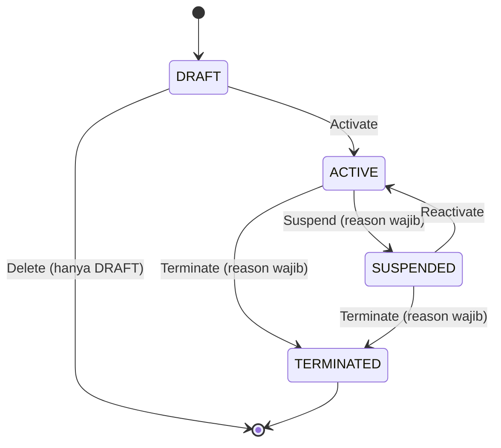

# PRD — Customer Contract (Kontrak PKS Penjamin)

## 1. Tujuan

Menyimpan kontrak kerja sama (PKS) antara rumah sakit dan customer/penjamin. Satu customer boleh punya banyak kontrak. Kontrak menjadi acuan untuk:

- **Termin pembayaran** dan **batas kredit** penjamin.
- **Syarat jaminan** (misal wajib SPPK per kunjungan).
- **Price schema** yang boleh dipakai saat registrasi (lihat [priceschema/PRD.md](../priceschema/PRD.md)).

### Non-goals (fase 1)
- Penegakan keras batas kredit (blokir charge). Fase 1 hanya informatif.
- Penerbitan dokumen SPPK/surat jaminan per kunjungan (milik modul registrasi/billing).
- Plafon biaya per item/encounter.

---

## 2. Keputusan Arsitektur

| # | Topik | Keputusan |
|---|---|---|
| D1 | Jalur | **Jalur B**: ada state transition (Activate/Suspend/Terminate/Renew) dan audit finansial. |
| D2 | Status | Status lifecycle disimpan: `DRAFT`, `ACTIVE`, `SUSPENDED`, `TERMINATED`. Status **"expired" tidak disimpan**, tapi dihitung dari tanggal. |
| D3 | Berlaku atau tidak | Kontrak **berlaku** pada tanggal `d` jika `status = ACTIVE` dan `effective_date <= d` dan (`expiration_date IS NULL` atau `d <= expiration_date`). |
| D4 | Jumlah kontrak | Satu customer boleh punya beberapa kontrak yang berlaku bersamaan. Petugas memilih kontrak saat registrasi; `customer_contract_id` disimpan di registrasi. |
| D5 | Nomor kontrak | `contract_number` unik secara global. |
| D6 | Tanggal | `effective_date` wajib; `expiration_date` boleh kosong (tanpa batas waktu). |
| D7 | Perpanjangan | Renewal = **kontrak baru** yang menunjuk kontrak lama lewat `renewed_from_contract_id`. Kontrak lama tidak diubah tanggalnya. |
| D8 | Termin | `payment_term_days` + `payment_term_notes`. Label "Net 30" dibuat saat ditampilkan. |
| D9 | Batas kredit | `credit_limit` nullable: `NULL` = tanpa batas, `0` = tidak boleh kredit. Fase 1 hanya informatif. |
| D10 | Jaminan | Kontrak hanya menyimpan **syarat** (`guarantee_requirement`). Dokumen SPPK/surat jaminan dibuat per registrasi/encounter di modul lain. |
| D11 | Edit kontrak aktif | Kontrak `ACTIVE` hanya boleh mengubah field non-finansial lewat update biasa. Perubahan termin, limit, atau tanggal harus lewat use case khusus dengan `reason` yang dicatat di audit. |

---

## 3. Lifecycle



| Transisi | Syarat (invariant) |
|---|---|
| `Activate` | Customer aktif. Minimal 1 price schema aktif terhubung ke kontrak. `effective_date` terisi. |
| `Suspend` | Hanya dari `ACTIVE`. `reason` wajib. |
| `Reactivate` | Hanya dari `SUSPENDED`. Syarat sama dengan `Activate`. |
| `Terminate` | Dari `ACTIVE` atau `SUSPENDED`. `reason` wajib. Tidak bisa dibatalkan. |
| `Delete` | Hanya `DRAFT` (hard delete). Kontrak yang pernah aktif tidak pernah dihapus. |
| `Renew` | Dari kontrak `ACTIVE`/`TERMINATED`. Membuat kontrak `DRAFT` baru dengan salinan termin, syarat, dan price schema, serta `renewed_from_contract_id` terisi. |

Aturan tambahan:
- Kontrak yang `SUSPENDED`, `TERMINATED`, atau di luar tanggal berlaku **tidak bisa dipilih** untuk registrasi baru.
- Perubahan status kontrak **tidak memengaruhi registrasi yang sudah berjalan**. Registrasi tetap memakai kontrak yang dipilih saat registrasi.
- Setiap transisi mengunci baris kontrak (`SELECT ... FOR UPDATE`) supaya dua transisi bersamaan tidak saling menimpa.

---

## 4. Skema Database

> Konvensi mengikuti migrasi yang sudah ada: ID `VARCHAR(36)` berisi UUIDv7, `TIMESTAMPTZ` (UTC), kolom audit `created_by`/`updated_by`. Dibuat lewat file Goose baru.

### 4.1 `customer_contracts`

```sql
CREATE TABLE customer_contracts (
    id                        VARCHAR(36)   PRIMARY KEY,
    customer_id               VARCHAR(36)   NOT NULL REFERENCES customers(id) ON DELETE RESTRICT,
    contract_number           VARCHAR(100)  NOT NULL,
    name                      VARCHAR(150)  NOT NULL,
    effective_date            DATE          NOT NULL,
    expiration_date           DATE,
    status                    VARCHAR(20)   NOT NULL DEFAULT 'DRAFT',
    payment_term_days         INT           NOT NULL,
    payment_term_notes        TEXT,
    credit_limit              NUMERIC(15,2),
    guarantee_requirement     VARCHAR(30)   NOT NULL DEFAULT 'NONE',
    guarantee_notes           TEXT,
    renewed_from_contract_id  VARCHAR(36)   REFERENCES customer_contracts(id) ON DELETE RESTRICT,
    notes                     TEXT,
    activated_at              TIMESTAMPTZ,
    activated_by              VARCHAR(50),
    terminated_at             TIMESTAMPTZ,
    terminated_by             VARCHAR(50),
    status_reason             TEXT,
    created_at                TIMESTAMPTZ   NOT NULL DEFAULT CURRENT_TIMESTAMP,
    updated_at                TIMESTAMPTZ   NOT NULL DEFAULT CURRENT_TIMESTAMP,
    created_by                VARCHAR(50)   NOT NULL,
    updated_by                VARCHAR(50)   NOT NULL,

    CONSTRAINT chk_cc_status
        CHECK (status IN ('DRAFT', 'ACTIVE', 'SUSPENDED', 'TERMINATED')),
    CONSTRAINT chk_cc_dates
        CHECK (expiration_date IS NULL OR expiration_date >= effective_date),
    CONSTRAINT chk_cc_payment_term
        CHECK (payment_term_days > 0),
    CONSTRAINT chk_cc_credit_limit
        CHECK (credit_limit IS NULL OR credit_limit >= 0),
    CONSTRAINT chk_cc_guarantee
        CHECK (guarantee_requirement IN ('NONE', 'SPPK', 'LETTER_OF_GUARANTEE')),
    CONSTRAINT chk_cc_not_self_renewal
        CHECK (renewed_from_contract_id IS NULL OR renewed_from_contract_id <> id)
);

CREATE UNIQUE INDEX idx_cc_contract_number ON customer_contracts(contract_number);
CREATE INDEX idx_cc_customer_status ON customer_contracts(customer_id, status);
CREATE INDEX idx_cc_dates ON customer_contracts(effective_date, expiration_date);
CREATE INDEX idx_cc_renewed_from ON customer_contracts(renewed_from_contract_id);
```

### 4.2 `customer_contract_price_schemas`

```sql
CREATE TABLE customer_contract_price_schemas (
    id                    VARCHAR(36) PRIMARY KEY,
    customer_contract_id  VARCHAR(36) NOT NULL REFERENCES customer_contracts(id) ON DELETE CASCADE,
    price_schema_id       VARCHAR(36) NOT NULL REFERENCES price_schemas(id) ON DELETE RESTRICT,
    priority              INT         NOT NULL DEFAULT 1,
    is_active             BOOLEAN     NOT NULL DEFAULT TRUE,
    created_at            TIMESTAMPTZ NOT NULL DEFAULT CURRENT_TIMESTAMP,
    updated_at            TIMESTAMPTZ NOT NULL DEFAULT CURRENT_TIMESTAMP,
    created_by            VARCHAR(50) NOT NULL,
    updated_by            VARCHAR(50) NOT NULL,

    CONSTRAINT chk_ccps_priority CHECK (priority > 0)
);

CREATE UNIQUE INDEX idx_ccps_contract_schema ON customer_contract_price_schemas(customer_contract_id, price_schema_id);
CREATE UNIQUE INDEX idx_ccps_contract_priority ON customer_contract_price_schemas(customer_contract_id, priority) WHERE is_active;
CREATE INDEX idx_ccps_price_schema ON customer_contract_price_schemas(price_schema_id);
```

- `ON DELETE CASCADE` hanya relevan untuk kontrak `DRAFT` (satu-satunya yang boleh dihapus).
- `priority` dipakai untuk mengurutkan pilihan schema dan menentukan **default** di form registrasi. Priority tidak dipakai saat lookup harga.
- Price schema yang ditautkan harus aktif. Validasinya lewat query contract milik `priceschema`, bukan dengan membaca tabel `price_schemas` secara langsung.

### 4.3 Semantik kolom

| Kolom | Arti |
|---|---|
| `name` | Label yang mudah dibaca, misal "PKS Rawat Inap 2026". Membantu petugas memilih jika customer punya beberapa kontrak. |
| `payment_term_days` | Jumlah hari jatuh tempo tagihan sejak invoice diterbitkan. |
| `credit_limit` | `NULL` = tanpa batas; `0` = tidak boleh kredit; `> 0` = batas outstanding. Fase 1 hanya peringatan. |
| `guarantee_requirement` | Syarat jaminan per kunjungan: `NONE`, `SPPK`, atau `LETTER_OF_GUARANTEE`. Registrasi wajib melampirkan dokumen sesuai syarat ini. |
| `status_reason` | Alasan transisi terakhir (suspend/terminate). Riwayat lengkap ada di audit. |

---

## 5. Use Case

| Use case | Keterangan |
|---|---|
| `CreateContract` | Buat kontrak `DRAFT` beserta tautan price schema (opsional) + audit. |
| `UpdateContractDraft` | Ubah semua field selama masih `DRAFT`. |
| `UpdateContractInfo` | Ubah field non-finansial (`name`, `notes`, `guarantee_notes`, `payment_term_notes`) pada kontrak `ACTIVE`/`SUSPENDED`. |
| `AmendContractTerms` | Ubah `payment_term_days`, `credit_limit`, `expiration_date`, atau `guarantee_requirement` pada kontrak `ACTIVE`/`SUSPENDED`. **`reason` wajib**; audit menyimpan before/after. `effective_date` tidak bisa diubah setelah aktif. |
| `ActivateContract` / `ReactivateContract` | Lihat invariant §3. |
| `SuspendContract` / `TerminateContract` | `reason` wajib. |
| `RenewContract` | Lihat §3. |
| `DeleteDraftContract` | Hanya `DRAFT`. |
| `LinkPriceSchema` / `UnlinkPriceSchema` / `ReorderPriceSchemas` | Melepas tautan pada kontrak `ACTIVE` ditolak jika itu satu-satunya schema aktif. |

Semua use case di atas:
- Ditulis dalam satu transaksi bersama audit append-only (`TransactionManager` + `AuditWriter`).
- Mengambil actor dari authenticated context, **bukan** dari body atau header mentah.
- Membutuhkan permission `finance.customer_contract.manage`. Baca/list cukup `finance.customer_contract.view`.

---

## 6. Contract untuk Modul Lain

```go
type ContractQuery interface {
	// ListSelectableContracts mengembalikan kontrak yang berlaku pada tanggal tertentu
	// untuk dipilih di form registrasi.
	ListSelectableContracts(ctx context.Context, customerID string, on time.Time) ([]SelectableContract, error)

	// ValidateContractSelection memastikan kontrak berlaku dan price schema termasuk
	// schema aktif milik kontrak tersebut. Dipakai oleh registrasi sebelum menyimpan.
	ValidateContractSelection(ctx context.Context, contractID, priceSchemaID string, on time.Time) (ContractSnapshot, error)
}

type SelectableContract struct {
	ContractID           string
	ContractNumber       string
	Name                 string
	GuaranteeRequirement GuaranteeRequirement
	PriceSchemas         []SchemaOption // urut berdasarkan priority; elemen pertama = default
}
```

- Registrasi menyimpan `customer_contract_id`, `price_schema_id`, dan `guarantee_requirement` saat itu.
- Billing membaca termin dan batas kredit lewat contract ini, tidak query langsung ke tabel.
- Pasien umum (tanpa penjamin) tidak memakai kontrak; `customer_contract_id` dan `price_schema_id` kosong.

---

## 7. Dampak ke Modul Lain

| Modul | Perubahan |
|---|---|
| `customer` | Menonaktifkan customer **tidak** otomatis mengubah status kontrak, tetapi kontrak milik customer nonaktif tidak bisa dipilih untuk registrasi baru dan tidak bisa di-activate. |
| `priceschema` | Menyediakan query contract untuk cek schema aktif. Menonaktifkan schema yang menjadi satu-satunya schema aktif sebuah kontrak `ACTIVE` harus ditolak, atau memberi peringatan (lihat Open Question Q2). |
| registrasi | Simpan `customer_contract_id`, `price_schema_id`, dan dokumen jaminan sesuai `guarantee_requirement`. |
| `billing` | Hitung jatuh tempo dari `payment_term_days`. Tampilkan peringatan jika outstanding melebihi `credit_limit`. |

---

## 8. Endpoint (draft)

- `GET    /api/v1/finance/customer-contracts` — list (pagination, filter `customer_id`, `status`, `valid_on`, `q`).
- `POST   /api/v1/finance/customer-contracts`
- `GET    /api/v1/finance/customer-contracts/:id`
- `PUT    /api/v1/finance/customer-contracts/:id` — `UpdateContractDraft` atau `UpdateContractInfo` sesuai status.
- `POST   /api/v1/finance/customer-contracts/:id/amend`
- `POST   /api/v1/finance/customer-contracts/:id/activate`
- `POST   /api/v1/finance/customer-contracts/:id/suspend`
- `POST   /api/v1/finance/customer-contracts/:id/reactivate`
- `POST   /api/v1/finance/customer-contracts/:id/terminate`
- `POST   /api/v1/finance/customer-contracts/:id/renew`
- `DELETE /api/v1/finance/customer-contracts/:id` — hanya `DRAFT`.
- `PUT    /api/v1/finance/customer-contracts/:id/price-schemas` — set daftar schema + priority.
- `GET    /api/v1/finance/customers/:customer_id/selectable-contracts?on=YYYY-MM-DD`

---

## 9. Open Questions

| # | Pertanyaan | Usulan sementara |
|---|---|---|
| Q1 | Perlu notifikasi kontrak yang akan habis (misal H-30)? | Ya, sebagai fitur read-only (list `expiring_within=30`) tanpa job yang mengubah status. |
| Q2 | Bagaimana jika price schema dinonaktifkan padahal menjadi satu-satunya schema aktif kontrak `ACTIVE`? | Tolak penonaktifan; tampilkan daftar kontrak yang terdampak. |
| Q3 | Apakah perlu lampiran file PKS (PDF)? | Fase berikutnya, lewat modul penyimpanan dokumen. |
