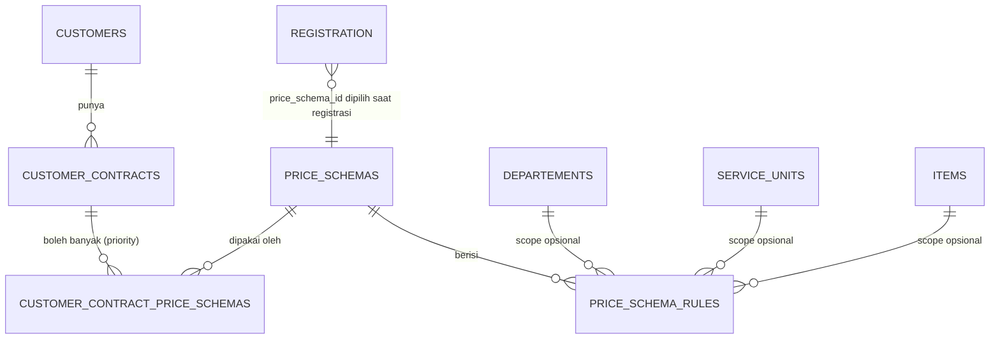

# PRD — Price Schema (Skema Harga per PKS Customer)

## 1. Tujuan

Membuat sistem tarif yang fleksibel untuk menyesuaikan harga setiap customer/penjamin sesuai **PKS (Perjanjian Kerja Sama)** antara rumah sakit dan customer, tanpa menduplikasi buku tarif.

- **Price Plan** (`internal/finance/priceplan`) = buku tarif **dasar** RS (harga per item × kelas tarif, beserta rincian komponen).
- **Price Schema** (`internal/finance/priceschema`) = aturan **penyesuaian** (markup/diskon/harga tetap, cost sharing, pajak) yang diterapkan di atas harga dasar untuk customer tertentu.

> [!WARNING]
> **Ruang lingkup fase 1: tarif tindakan/layanan saja.** Kolom `medication_*` sudah disiapkan di skema, tetapi **belum dipakai** dalam kalkulasi. Obat dan BHP adalah technical debt untuk fase berikutnya.

### Non-goals (fase 1)
- Kalkulasi harga obat dan BHP.
- Penghitungan ulang otomatis charge yang sudah dibuat ketika schema berubah.
- Pengaturan harga Cito oleh schema (Cito selalu mengikuti Price Plan).

---

## 2. Keputusan Arsitektur

| # | Topik | Keputusan |
|---|---|---|
| D1 | Price Plan vs Price Schema | Price Plan hanya menjadi buku tarif dasar RS. `tariff_price_plans.customer_id` di-**deprecate** (lihat §9). Satu-satunya sumber penyesuaian per customer adalah Contract → Price Schema. |
| D2 | Arti "Service" | Service = `service_units` (modul organization). |
| D3 | Bentuk hierarki | Satu tabel rule dengan scope opsional (`departement_id`, `service_unit_id`, `item_id` nullable), bukan tabel bertingkat dengan FK berantai. |
| D4 | Penggabungan level | **Override**: rule paling spesifik yang cocok dipakai **sepenuhnya**; level di atasnya diabaikan. Tidak ada penjumlahan antarlevel. |
| D5 | Satuan penyesuaian | `adjustment_type` (`NONE` \| `PERCENT` \| `FIXED_AMOUNT` \| `FIXED_PRICE`) + `adjustment_value`. |
| D6 | Pemilihan schema | Satu kontrak boleh punya banyak schema (dengan `priority`). **`price_schema_id` ditentukan saat registrasi** dan disimpan di registrasi/encounter. Lookup tidak menebak schema. |
| D7 | Versioning | Schema dan rule boleh diedit langsung. Tagihan historis aman karena billing menyimpan **snapshot** hasil kalkulasi. |
| D8 | Audit | Setiap mutasi schema/rule **wajib** menulis audit append-only (before/after) dalam transaksi yang sama. |
| D9 | Cito | Tidak diatur oleh schema. Biaya tambahan Cito diambil dari Price Plan (lihat §5.3). |
| D10 | Komponen tarif | Selisih (final − base) didistribusikan proporsional ke komponen Price Plan (lihat §5.5). |
| D11 | Batas modul | Billing yang melakukan kalkulasi akhir. priceschema memiliki data rule **dan** logika pencocokan rule, lalu mengeksposnya lewat read contract (lihat §6). |

---

## 3. Model Konsep



### 3.1 Level rule (diturunkan dari kombinasi scope)

| Level | `item_id` | `service_unit_id` | `departement_id` | Prioritas lookup |
|---|---|---|---|---|
| `ITEM_UNIT` | ✔ | ✔ | — | 1 (paling spesifik) |
| `ITEM_DEPT` | ✔ | — | ✔ | 2 |
| `ITEM` | ✔ | — | — | 3 |
| `UNIT` | — | ✔ | — | 4 |
| `DEPT` | — | — | ✔ | 5 |
| `SCHEMA_DEFAULT` | — | — | — | 6 |
| *(tidak ada rule)* | | | | Harga dasar Price Plan tanpa penyesuaian |

Aturan: `service_unit_id` dan `departement_id` **tidak boleh diisi bersamaan**. Departement dari sebuah service unit diturunkan dari data organization saat lookup, bukan disimpan dobel, supaya tidak terjadi inkonsistensi bila unit dipindah departement.

---

## 4. Skema Database

> Konvensi mengikuti migrasi yang sudah ada: ID `VARCHAR(36)` berisi UUIDv7, timestamp `TIMESTAMPTZ` (UTC), kolom audit `created_by`/`updated_by`. Semua perubahan schema dibuat melalui file Goose baru di `migrations/`.

### 4.1 `price_schemas`

```sql
CREATE TABLE price_schemas (
    id          VARCHAR(36)  PRIMARY KEY,
    code        VARCHAR(50)  NOT NULL,
    name        VARCHAR(150) NOT NULL,
    description TEXT,
    is_active   BOOLEAN      NOT NULL DEFAULT TRUE,
    created_at  TIMESTAMPTZ  NOT NULL DEFAULT CURRENT_TIMESTAMP,
    updated_at  TIMESTAMPTZ  NOT NULL DEFAULT CURRENT_TIMESTAMP,
    created_by  VARCHAR(50)  NOT NULL,
    updated_by  VARCHAR(50)  NOT NULL
);
CREATE UNIQUE INDEX idx_price_schemas_code ON price_schemas(code);
```

- Tidak memakai soft delete. Schema yang sudah dipakai registrasi **tidak boleh dihapus**; nonaktifkan dengan `is_active = FALSE`.
- Schema nonaktif tidak boleh dipilih untuk registrasi baru. Registrasi berjalan tetap memakai schema tersebut.

### 4.2 `price_schema_rules`

```sql
CREATE TABLE price_schema_rules (
    id                VARCHAR(36) PRIMARY KEY,
    price_schema_id   VARCHAR(36) NOT NULL REFERENCES price_schemas(id) ON DELETE RESTRICT,
    departement_id    VARCHAR(36) REFERENCES departements(id) ON DELETE RESTRICT,
    service_unit_id   VARCHAR(36) REFERENCES service_units(id) ON DELETE RESTRICT,
    item_id           VARCHAR(36) REFERENCES items(id) ON DELETE RESTRICT,

    -- Tarif tindakan (fase 1)
    tariff_adjustment_type   VARCHAR(20)   NOT NULL DEFAULT 'NONE',
    tariff_adjustment_value  NUMERIC(15,4) NOT NULL DEFAULT 0,

    -- Obat (fase 2, BELUM dipakai kalkulasi)
    medication_adjustment_type  VARCHAR(20)   NOT NULL DEFAULT 'NONE',
    medication_adjustment_value NUMERIC(15,4) NOT NULL DEFAULT 0,

    -- Cost sharing (persen dari harga bruto setelah pajak)
    pay_by_patient_percent  NUMERIC(5,2) NOT NULL DEFAULT 0,
    pay_by_customer_percent NUMERIC(5,2) NOT NULL DEFAULT 100,

    -- Pajak (persen dari final_price)
    tax_percent NUMERIC(5,2) NOT NULL DEFAULT 0,

    created_at TIMESTAMPTZ NOT NULL DEFAULT CURRENT_TIMESTAMP,
    updated_at TIMESTAMPTZ NOT NULL DEFAULT CURRENT_TIMESTAMP,
    created_by VARCHAR(50) NOT NULL,
    updated_by VARCHAR(50) NOT NULL,

    CONSTRAINT chk_psr_scope_exclusive
        CHECK (NOT (departement_id IS NOT NULL AND service_unit_id IS NOT NULL)),
    CONSTRAINT chk_psr_tariff_type
        CHECK (tariff_adjustment_type IN ('NONE','PERCENT','FIXED_AMOUNT','FIXED_PRICE')),
    CONSTRAINT chk_psr_medication_type
        CHECK (medication_adjustment_type IN ('NONE','PERCENT','FIXED_AMOUNT','FIXED_PRICE')),
    CONSTRAINT chk_psr_tariff_value CHECK (
        (tariff_adjustment_type = 'NONE'        AND tariff_adjustment_value = 0) OR
        (tariff_adjustment_type = 'PERCENT'     AND tariff_adjustment_value >= -100) OR
        (tariff_adjustment_type = 'FIXED_AMOUNT') OR
        (tariff_adjustment_type = 'FIXED_PRICE' AND tariff_adjustment_value >= 0 AND item_id IS NOT NULL)
    ),
    CONSTRAINT chk_psr_cost_share CHECK (
        pay_by_patient_percent BETWEEN 0 AND 100 AND
        pay_by_customer_percent BETWEEN 0 AND 100 AND
        pay_by_patient_percent + pay_by_customer_percent = 100
    ),
    CONSTRAINT chk_psr_tax CHECK (tax_percent BETWEEN 0 AND 100)
);

-- Satu rule per kombinasi scope di dalam satu schema
CREATE UNIQUE INDEX idx_psr_scope_unique ON price_schema_rules (
    price_schema_id,
    COALESCE(departement_id, ''),
    COALESCE(service_unit_id, ''),
    COALESCE(item_id, '')
);
CREATE INDEX idx_psr_lookup_item ON price_schema_rules(price_schema_id, item_id);
CREATE INDEX idx_psr_departement ON price_schema_rules(departement_id);
CREATE INDEX idx_psr_service_unit ON price_schema_rules(service_unit_id);
```

### 4.3 Semantik kolom

| Kolom | Satuan | Arti |
|---|---|---|
| `tariff_adjustment_type = NONE` | — | Pakai harga dasar apa adanya. Berguna untuk **menetralkan** rule level atas, misalnya item tertentu dikecualikan dari diskon departement. |
| `PERCENT` | % | `final = base × (1 + value/100)`. Positif = markup, negatif = diskon. Minimum −100. |
| `FIXED_AMOUNT` | Rupiah | `final = base + value`. Positif = markup, negatif = potongan. Hasil akhir di-clamp minimal 0. |
| `FIXED_PRICE` | Rupiah | `final = value`. Harga kesepakatan PKS. **Hanya boleh pada rule yang memiliki `item_id`.** |
| `pay_by_patient_percent` / `pay_by_customer_percent` | % | Porsi tanggungan dari harga bruto (final + pajak). Jumlahnya wajib 100. |
| `tax_percent` | % | Pajak yang dihitung dari `final_price` (setelah penyesuaian). |
| `medication_*` | — | Disiapkan untuk fase 2. Diabaikan oleh kalkulasi fase 1. |

> [!IMPORTANT]
> Karena semantiknya **override**, rule yang cocok dipakai untuk **semua kolom sekaligus**. Tidak ada pewarisan per kolom dari level atas. Karena itu semua kolom `NOT NULL` dengan default eksplisit.

### 4.4 Relasi kontrak (revisi `customercontract/PRD.md`)

```sql
CREATE TABLE customer_contract_price_schemas (
    id                   VARCHAR(36) PRIMARY KEY,
    customer_contract_id VARCHAR(36) NOT NULL REFERENCES customer_contracts(id) ON DELETE RESTRICT,
    price_schema_id      VARCHAR(36) NOT NULL REFERENCES price_schemas(id) ON DELETE RESTRICT,
    priority             INT         NOT NULL DEFAULT 1 CHECK (priority > 0),
    is_active            BOOLEAN     NOT NULL DEFAULT TRUE,
    created_at TIMESTAMPTZ NOT NULL DEFAULT CURRENT_TIMESTAMP,
    updated_at TIMESTAMPTZ NOT NULL DEFAULT CURRENT_TIMESTAMP,
    created_by VARCHAR(50) NOT NULL,
    updated_by VARCHAR(50) NOT NULL
);
CREATE UNIQUE INDEX idx_ccps_contract_schema ON customer_contract_price_schemas(customer_contract_id, price_schema_id);
CREATE UNIQUE INDEX idx_ccps_contract_priority ON customer_contract_price_schemas(customer_contract_id, priority) WHERE is_active;
```

- `priority` hanya dipakai untuk **mengurutkan pilihan dan menentukan default** di form registrasi. Priority tidak dipakai saat lookup harga.
- Tabel ini milik modul `customercontract`. priceschema tidak menulis ke tabel ini.

---

## 5. Algoritma Kalkulasi Harga Tarif

### 5.1 Input

| Field | Sumber |
|---|---|
| `price_schema_id` | Registrasi/encounter (dipilih saat registrasi, D6). Nullable untuk pasien umum tanpa PKS. |
| `tariff_class_id` | Registrasi |
| `departement_id`, `service_unit_id` | Unit tempat layanan diberikan (bukan dibaca langsung dari tabel registrasi oleh priceschema) |
| `item_id` | Item yang di-charge atau disimulasikan |
| `service_date` | Tanggal layanan (untuk memilih Price Plan yang efektif) |
| `is_cito` | Flag Cito pada order |

### 5.2 Langkah

```text
1. base := priceplan.LookupTariff(tariff_class_id, item_id, service_date, is_cito)
      -> total_base_price, total_cito_price, components[]
      (memakai buku tarif default RS, D1; tidak query langsung ke tariff_price_plan_items)
      jika tidak ditemukan -> ErrTariffNotConfigured

2. jika price_schema_id kosong -> rule := nil
   selain itu:
      rule, level := priceschema.FindMatchingRule(price_schema_id, item_id, departement_id, service_unit_id)
      urutan pencocokan: ITEM_UNIT > ITEM_DEPT > ITEM > UNIT > DEPT > SCHEMA_DEFAULT
      ambil rule PERTAMA yang ditemukan (override, D4)

3. final_price := applyAdjustment(base.total_base_price, rule.tariff_adjustment_type, rule.tariff_adjustment_value)
      (rule nil -> NONE)
      final_price := max(0, ROUND_HALF_UP(final_price, 0))

4. jika is_cito:
      cito_surcharge := base.total_cito_price - base.total_base_price   (D9, tidak diubah schema)
      final_price    := final_price + cito_surcharge

5. tax_amount := ROUND_HALF_UP(final_price × rule.tax_percent / 100, 0)
   gross      := final_price + tax_amount

6. jika rule == nil:
      patient_amount  := gross
      customer_amount := 0
   selain itu:
      patient_amount  := ROUND_HALF_UP(gross × rule.pay_by_patient_percent / 100, 0)
      customer_amount := gross - patient_amount        (sisa pembulatan masuk customer agar total tetap sama)

7. components := distribusikan(final_price, base.components)   (lihat §5.5)
```

### 5.3 Cito
Cito tidak diatur schema. Biaya tambahan Cito = `total_cito_price − total_base_price` dari Price Plan, lalu ditambahkan **setelah** penyesuaian schema. Artinya diskon/markup PKS hanya berlaku untuk harga dasar.

### 5.4 Pembulatan
Semua nominal dibulatkan ke rupiah utuh dengan `ROUND_HALF_UP`. Perhitungan memakai tipe desimal (misal `shopspring/decimal`); **dilarang memakai `float64`**.

### 5.5 Distribusi ke komponen tarif
1. `delta := final_price_tanpa_cito − total_base_price`.
2. Setiap komponen `i`: `amount_i := ROUND_HALF_UP(base_i + delta × base_i / total_base_price, 0)`.
3. Sisa pembulatan (`final − Σ amount_i`) ditambahkan ke komponen bertipe **Jasa RS/Sarana**.
4. Jika `total_base_price = 0`, seluruh `delta` masuk ke komponen Jasa RS.
5. Komponen Cito didistribusikan sesuai `cito_amount` per komponen dari Price Plan.
6. `coa_code` per komponen tetap mengikuti Price Plan.

### 5.6 Contoh

Harga dasar Rp 200.000 (Jasa RS 120.000, Jasa Dokter 80.000). Rule `DEPT` = `PERCENT −10`, tax 0, patient 0 / customer 100.

| Langkah | Nilai |
|---|---|
| final_price | 200.000 × 0,9 = **180.000** |
| delta | −20.000 |
| Jasa RS | 120.000 − 12.000 = 108.000 |
| Jasa Dokter | 80.000 − 8.000 = 72.000 |
| customer_amount | 180.000 |

Jika item yang sama punya rule `ITEM` = `NONE`, hasilnya Rp 200.000. Rule `DEPT` diabaikan karena override.

---

## 6. Batas Modul dan Contract

```text
registration/encounter --(price_schema_id, tariff_class_id, unit)--> billing
billing --LookupTariff-------------------------------------------> finance/priceplan
billing --FindMatchingRule---------------------------------------> finance/priceschema
billing: menghitung final price, pajak, cost sharing, distribusi komponen, lalu menyimpan snapshot
```

### 6.1 Read contract yang diekspos priceschema

```go
// MatchLevel menunjukkan level scope rule yang cocok.
type MatchLevel string

type MatchedRule struct {
	RuleID                string
	PriceSchemaID         string
	Level                 MatchLevel
	TariffAdjustmentType  AdjustmentType
	TariffAdjustmentValue decimal.Decimal
	PayByPatientPercent   decimal.Decimal
	PayByCustomerPercent  decimal.Decimal
	TaxPercent            decimal.Decimal
}

type RuleMatcher interface {
	// FindMatchingRule mengembalikan rule paling spesifik sesuai urutan override.
	// Mengembalikan ErrNoMatchingRule bila schema tidak memiliki rule yang cocok.
	FindMatchingRule(ctx context.Context, q MatchRuleQuery) (MatchedRule, error)
}
```

- Logika urutan override adalah **invariant priceschema**, jadi tetap berada di priceschema walaupun kalkulasi nominal ada di billing.
- Billing **dilarang** membaca tabel `price_schema_*` secara langsung atau mengimpor package persistence priceschema (AGENTS.md §8, §11).
- Fungsi murni untuk adjustment (`ApplyAdjustment`, `DistributeToComponents`) boleh diekspos sebagai domain function supaya billing dan endpoint simulasi memakai rumus yang sama.
- Lookup departement dari `service_unit_id` dilakukan lewat query contract modul organization.

### 6.2 Validasi saat registrasi (milik modul registrasi/workflow)
- `price_schema_id` wajib termasuk schema aktif milik `customer_contract_id` yang dipilih.
- Kontrak harus aktif pada tanggal registrasi.
- Default yang ditampilkan di form = schema aktif dengan `priority` terkecil.

---

## 7. Mutasi Schema dan Audit

Klasifikasi: **Jalur B** untuk operasi tulis.

Walaupun bentuknya mirip CRUD, mutasi schema memenuhi kriteria Jalur B (AGENTS.md §2): ada audit bernilai finansial yang wajib atomik (D8), dan ada beberapa write dalam satu operasi (header + rules + audit). Kalkulasi dan list tetap memakai read/query path.

| Use case | Keterangan |
|---|---|
| `CreatePriceSchema` | Header + rule awal (opsional) + audit, dalam satu transaksi. |
| `UpdatePriceSchema` | Ubah nama/deskripsi/status + audit. |
| `UpsertPriceSchemaRule` | Tambah/ubah satu rule; validasi scope (departement/unit/item ada dan aktif via contract owner) + audit before/after. |
| `DeletePriceSchemaRule` | Hard delete rule + audit (snapshot rule yang dihapus). |
| `DeactivatePriceSchema` | `is_active = FALSE` + audit. |

Aturan:
- Audit append-only ditulis lewat port `AuditWriter` dalam transaksi yang sama melalui `TransactionManager`. Jika audit gagal, mutasi juga gagal.
- Isi audit: actor, role efektif, action, resource (`price_schema` / `price_schema_rule`), resource ID, before/after, timestamp, correlation ID.
- Actor diambil dari authenticated context, **bukan** dari body atau header mentah.
- Perubahan schema **tidak** menghitung ulang charge yang sudah dibuat, termasuk charge rawat inap yang encounter-nya masih berjalan (D7).

> [!NOTE]
> Port `TransactionManager` dan `AuditWriter` belum ada di repository. Keduanya perlu dibuat sebagai prasyarat (lihat §10).

---

## 8. Snapshot di Billing (kontrak dengan modul billing)

Setiap charge line wajib menyimpan:

| Field | Keterangan |
|---|---|
| `price_plan_id`, `price_plan_item_id` | Sumber harga dasar |
| `base_price`, `cito_surcharge` | Dari Price Plan |
| `price_schema_id`, `price_schema_rule_id`, `match_level` | Rule yang dipakai (nullable) |
| `adjustment_type`, `adjustment_value` | Salinan nilai rule saat itu |
| `final_price`, `tax_amount`, `patient_amount`, `customer_amount` | Hasil kalkulasi |
| komponen (`component_id`, `amount`, `coa_code`) | Hasil distribusi |
| `priced_at` | Waktu kalkulasi (UTC) |

Tagihan lama **tidak boleh** membaca ulang price schema.

---

## 9. Dampak ke Modul Lain

| Modul | Perubahan |
|---|---|
| `priceplan` | `customer_id` di-deprecate. Pola expand → contract: (1) stop membuat plan baru dengan `customer_id`, (2) migrasikan plan customer yang ada menjadi rule `FIXED_PRICE` di schema, (3) hapus Langkah 1 di `internal/finance/priceplan/lookup_tariff.go` , (4) drop kolom lewat migrasi baru. |
| `customercontract` | Revisi PRD ke sintaks PostgreSQL (hapus `ON UPDATE CURRENT_TIMESTAMP` dan `enum` MySQL), tambah `priority` di pivot (§4.4). |
| registrasi/encounter | Simpan `customer_contract_id` dan `price_schema_id`; validasi §6.2. |
| `billing` | Konsumsi `LookupTariff` + `FindMatchingRule`, kalkulasi §5, simpan snapshot §8. |
| `organization` | Sediakan query contract untuk departement dari service unit dan cek status aktif. |

---

## 10. Prasyarat dan Urutan Implementasi

1. Port `TransactionManager` dan `AuditWriter` + tabel audit append-only (modul `audit`).
2. Migrasi `price_schemas` dan `price_schema_rules`.
3. Domain: `AdjustmentType`, `ApplyAdjustment`, `DistributeToComponents`, urutan override, beserta unit test (table-driven, termasuk kasus pembulatan).
4. Use case mutasi (§7) dan `RuleMatcher` (§6.1).
5. Endpoint simulasi harga (read-only) untuk verifikasi oleh tim keuangan sebelum billing selesai.
6. Deprecation `priceplan.customer_id` (§9).

### Endpoint (draft)
- `GET    /api/v1/finance/price-schemas` — list (pagination, filter `is_active`, `q`).
- `POST   /api/v1/finance/price-schemas`
- `GET    /api/v1/finance/price-schemas/:id`
- `PUT    /api/v1/finance/price-schemas/:id`
- `POST   /api/v1/finance/price-schemas/:id/deactivate`
- `GET    /api/v1/finance/price-schemas/:id/rules` — list (pagination, filter level/departement/unit/item).
- `PUT    /api/v1/finance/price-schemas/:id/rules` — upsert berdasarkan scope.
- `DELETE /api/v1/finance/price-schemas/:id/rules/:rule_id`
- `POST   /api/v1/finance/price-schemas/simulate` — input §5.1, output breakdown lengkap.

---

## 11. Keputusan Final & Batasan Tambahan

| # | Topik | Keputusan Final |
|---|---|---|
| Q1 | `tax_percent` | **PPN penambah nilai tagihan bruto**. Dihitung dari `final_price` setelah adjustment tarif, lalu total bruto (`final_price + tax_amount`) dibagi ke porsi pasien & customer sesuai persentase cost-sharing. |
| Q2 | Diskon PKS vs Cito | **Diskon PKS tidak memotong biaya Cito**. Tambahan biaya Cito ditambahkan secara penuh setelah adjustment tarif reguler selesai (§5.3). |
| Q3 | Tanggungan / Cost Sharing Fallback | **Setiap Price Schema WAJIB memiliki tepat 1 rule `SCHEMA_DEFAULT`** (seluruh scope ID bernilai NULL). Untuk pasien umum (tanpa `price_schema_id`), sistem billing mengasumsikan tanggungan 100% Pasien / Pribadi. |
| Q4 | Plafon Biaya / Plafon Layanan | Di luar fase 1; fitur limitasi kredit/plafon akan dikelola pada modul `customercontract`. |
| Q5 | Otorisasi Akses Mutasi | Dibatasi oleh permission RBAC khusus `finance.price_schema.manage`. Approval multi-step belum diperlukan di fase 1. |
