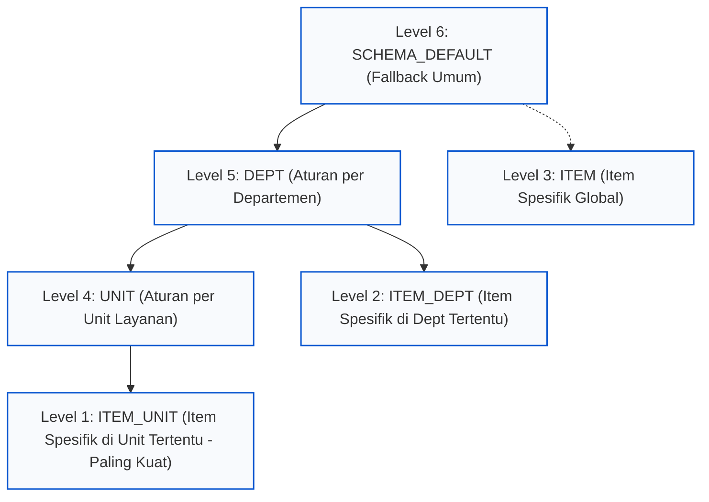

# PRD UI/UX — Pengelolaan Skema Tarif (Price Schema)
**HOSIM-GO — Modul Finance (Keuangan)**

Dokumen ini adalah spesifikasi resmi antarmuka pengguna (UI/UX) untuk modul **Price Schema**, yang mengimplementasikan arsitektur domain pada [`internal/finance/priceschema/PRD.md`](../../../../../../internal/finance/priceschema/PRD.md).

---

## 1. Ringkasan & Filosofi Desain

Sistem tarif HOSIM-GO memisahkan **Buku Tarif Dasar RS** (*Price Plan*) dari **Aturan Penyesuaian Rekanan PKS** (*Price Schema*).

### Mengapa Pola Hierarchical Tree Grid (Ala Modul Akuntansi COA)?
Sebelumnya, navigasi aturan tarif menggunakan modal bertingkat (*nested modals*: Skema $\rightarrow$ Departemen $\rightarrow$ Unit $\rightarrow$ Item Tindakan). Pola tersebut menimbulkan masalah UX berupa kolom tabel terhimpit, hilangnya konteks kerja, dan scroll ganda.

Mengadopsi pola **Hierarchical Tree View** (seperti pada [`CoaTreeView.svelte`](../../../pages/accounting/coa/components/CoaTreeView.svelte) di Bagan Akun Akuntansi):
1. **Visibilitas Hierarki Utuh**: Seluruh hierarki (*Default Skema* $\rightarrow$ *Departemen* $\rightarrow$ *Unit Layanan* $\rightarrow$ *Item Tindakan Khusus*) terlihat jelas dalam satu tampilan berjenjang.
2. **Visualisasi Pewarisan & Override**: Pengguna dapat melihat secara instan apakah suatu unit mewarisi aturan departemen (*Inherited*) atau memiliki aturan khusus (*Override*).
3. **Bebas Tumpukan Modal**: Pengguna dapat menjelajahi dan mencari aturan layanan dengan cepat melalui tombol *Expand/Collapse* tanpa membuka modal berlapis. Mutasi aturan cukup melalui satu drawer/modal form terfokus.
4. **Dilengkapi Simulator Real-time**: Staf keuangan dapat langsung menguji coba hasil lookup tarif sebelum skema diterapkan ke pendaftaran pasien.

---

## 2. Struktur Hierarki & Logika Inheritansi

Hierarki scope penyesuaian tarif mengikuti 6 tingkat prioritas backend:



### Logika Tampilan Baris Tree:
1. **Cabang Tingkat 1 (Departemen)**:
   - Menampilkan seluruh departemen aktif (contoh: *Rawat Jalan, Rawat Inap, IGD, Kamar Operasi, ICU*).
   - Memiliki nilai penyesuaian departemen atau mewarisi *Default Skema*.
2. **Cabang Tingkat 2 (Service Unit)**:
   - Merupakan anak dari departemen terkait (contoh: *Poli Umum, Poli Gigi, Laboratorium, Radiologi*).
   - Status:
     - `INHERITED`: Mewarisi aturan departemen (tampil dengan teks abu-abu/redup).
     - `OVERRIDE`: Memiliki aturan penyesuaian unit sendiri (tampil dengan badge hijau tegas).
3. **Cabang Tingkat 3 (Item Tindakan / Pengecualian Khusus)**:
   - Tindakan medis yang mendapatkan perlakuan khusus (misal: *Fixed Price* kesepakatan PKS, diskon khusus tindakan tertentu, atau cost sharing khusus).
4. **Cabang Mandiri (Pengecualian Item Global / Lintas Unit)**:
   - Bagian khusus untuk tindakan yang diatur langsung pada level skema tanpa terikat unit tertentu.

---

## 3. Peta Halaman & Komponen

```text
web/src/lib/pages/finance/priceschema/
├── IndexPage.svelte                   # Halaman daftar master skema tarif
├── SchemaDetailPage.svelte           # Halaman pengelola hierarki aturan & simulator
└── components/
    ├── PriceSchemaTable.svelte        # Tabel master skema tarif (di IndexPage)
    ├── PriceSchemaFormModal.svelte    # Modal create/edit master skema (header)
    ├── PriceSchemaDeleteModal.svelte  # Modal konfirmasi nonaktifkan skema
    ├── PriceSchemaTreeView.svelte     # Tree Grid hierarkis aturan (ala CoaTreeView)
    ├── PriceSchemaDefaultCard.svelte  # Kartu aturan default skema (SCHEMA_DEFAULT)
    ├── PriceSchemaRuleDrawer.svelte   # Drawer form tambah/edit aturan (rule)
    └── PriceSchemaSimulator.svelte    # Simulator uji coba kalkulasi tarif
```

---

## 4. Spesifikasi Halaman

### 4.1 Halaman Daftar Skema (`IndexPage.svelte`)

#### A. Header
- **Judul**: Skema Tarif Rekanan (PKS)
- **Deskripsi**: Kelola aturan penyesuaian tarif (diskon/markup/fixed price), pembagian tanggungan pasien vs penjamin (*cost sharing*), dan pajak berdasarkan perjanjian kerja sama rumah sakit.
- **Tombol Aksi**: `+ Tambah Skema`

#### B. Ringkasan Kartu KPI (Stats Bar)
- **Total Skema Aktif**: Jumlah skema yang dapat dipilih pada registrasi.
- **Skema Rekanan PKS**: Skema yang terhubung ke kontrak customer aktif.
- **Skema Umum RS**: Skema tarif pasien reguler.

#### C. Tabel Master Skema (`PriceSchemaTable.svelte`)

| Kolom | Tipe Tampilan | Keterangan |
|---|---|---|
| **Kode Skema** | Font Mono, Bold | Contoh: `BPJS-RJ-2026`, `STD-UMUM` |
| **Nama Skema** | Teks Utama | Nama resmi perjanjian atau skema |
| **Deskripsi** | Teks Sekunder | Catatan peruntukan skema |
| **Aturan Default** | Badge Ringkasan | Ringkasan fallback global (contoh: `Tarif: 0% • Pasien: 0% / Penjamin: 100%`) |
| **Total Aturan Khusus** | Counter Badge | Jumlah aturan override (Departemen, Unit, dan Item) |
| **Status** | Badge Status | `Aktif` (Hijau) / `Nonaktif` (Abu-abu) |
| **Aksi** | Tombol Aksi | 1. `Kelola Aturan` (Primary - Buka SchemaDetailPage)<br>2. `Edit Header`<br>3. `Nonaktifkan` / `Aktifkan` |

---

### 4.2 Halaman Pengelola Aturan Skema (`SchemaDetailPage.svelte`)

Halaman ini dibuka saat user mengklik tombol **Kelola Aturan** pada salah satu skema.

#### A. Breadcrumb & Top Bar
- **Breadcrumb**: `Keuangan` > `Skema Tarif` > `[Kode Skema] - [Nama Skema]`
- **Header Info**:
  - Kode & Nama Skema
  - Badge Status (`Aktif` / `Nonaktif`)
  - Tombol: `Kembali ke Daftar`, `Edit Header Skema`, `Simulasi Cepat`

#### B. Kartu Aturan Default Skema (`PriceSchemaDefaultCard.svelte`)
> [!IMPORTANT]
> Sesuai ketentuan backend PRD (§11 Q3), setiap skema **wajib** memiliki 1 rule fallback global (`SCHEMA_DEFAULT`).

Tampilan kartu di bagian atas:
- **Judul**: Aturan Dasar Skema (Global Fallback)
- **Keterangan**: Diterapkan pada seluruh layanan dan tindakan jika tidak ada aturan khusus pada level departemen, unit, atau item.
- **Nilai Saat Ini**:
  - Penyesuaian Tarif: `0% (Harga Dasar Price Plan)` / `Markup +5%` / `Diskon -10%`
  - Cost Sharing: `Pasien: 0%` | `Penjamin: 100%`
  - Pajak PPN: `11%` (atau `0%`)
  - Obat/BMHP: `0% (Fase 2)`
- **Aksi**: Tombol `Ubah Aturan Default` (Membuka drawer form dengan mode `SCHEMA_DEFAULT`).

#### C. Toolbar Tree Grid
- **Input Pencarian**: Cari berdasarkan nama departemen, nama poli/unit, atau nama tindakan medis. (Jika user mengetik, cabang yang cocok akan otomatis terbuka / *auto-expanded*).
- **Filter Status Aturan**:
  - `Semua Layanan`
  - `Hanya yang Memiliki Aturan Khusus (Override)`
  - `Mewarisi Aturan (Inherited)`
- **Filter Departemen**: Dropdown filter cepat per departemen.
- **Tombol Kontrol Pohon**:
  - `Buka Semua (Expand All)`
  - `Tutup Semua (Collapse All)`
- **Tombol Tambah**: `+ Tambah Aturan Khusus`

---

### 4.3 Komponen Hierarchical Tree Grid (`PriceSchemaTreeView.svelte`)

Tabel berjenjang yang mereplikasi kemudahan dan kejelasan [`CoaTreeView.svelte`](../../../pages/accounting/coa/components/CoaTreeView.svelte):

#### Struktur Header Grid:
```text
[ Struktur Layanan & Tindakan ]  [ Level Scope ]  [ Penyesuaian Tarif ]  [ Pasien % ]  [ Penjamin % ]  [ Pajak ]  [ Obat (Fase 2) ]  [ Aksi ]
```

#### Visualisasi Data per Baris:

```text
▼ 🏢 Rawat Jalan                               [ DEPT ]       Diskon -5%             0%          100%         11%        0%            [+ Unit] [Edit] [Reset]
    ▼ 🏥 Poli Umum                             [ UNIT ]       Diskon -10% (Override) 0%          100%         11%        0%            [+ Item] [Edit] [Reset]
        • 🩺 Konsultasi Dokter Umum            [ ITEM_UNIT ]  Rp 50.000 (Fixed Price)0%          100%         0%         -             [Edit] [Hapus]
        • 🩺 Rekam Jantung (EKG)               [ INHERITED ]  Diskon -10% (Ikut Unit)0%          100%         11%        -             [+ Override]
    ► 🏥 Poli Gigi                             [ INHERITED ]  Diskon -5% (Ikut Dept) 0%          100%         11%        0%            [+ Override]
    ► 🏥 Laboratorium                          [ UNIT ]       Diskon -15% (Override) 0%          100%         11%        0%            [+ Item] [Edit] [Reset]
▼ 🏢 Rawat Inap                                [ DEPT ]       Markup +10%            0%          100%         11%        0%            [+ Unit] [Edit] [Reset]
    ► 🏥 Kamar Perawatan Kelas 1               [ INHERITED ]  Markup +10%            0%          100%         11%        0%            [+ Override]
    ► 🏥 Intensive Care Unit (ICU)             [ UNIT ]       Markup +20% (Override) 0%          100%         11%        0%            [+ Item] [Edit] [Reset]
▼ 🌐 Pengecualian Tindakan Lintas Unit         [ SCOPE: ITEM ]
    • 🩺 Paket Tindakan Swab PCR               [ ITEM ]       Rp 250.000 (Fixed Price)100%       0%           0%         -             [Edit] [Hapus]
```

#### Spesifikasi Kolom:

1. **Struktur Layanan & Tindakan**:
   - Indentasi berbasis level (`depth * 20px`).
   - Tombol toggle `ChevronDown` (buka) / `ChevronRight` (tutup) untuk node yang memiliki sub-item.
   - Ikon penanda tipe:
     - 🏢 Departemen (`Building2`)
     - 🏥 Unit Layanan (`Stethoscope` / `Hospital`)
     - 🩺 Tindakan Medis (`Activity` / `Syringe`)
     - 🌐 Item Global (`Globe`)
   - Teks nama dan kode layanan.
2. **Level Scope & Status**:
   - `DEPT`: Badge warna ungu border tipis.
   - `UNIT` (Override): Badge warna biru tegas.
   - `ITEM_UNIT` / `ITEM_DEPT` / `ITEM`: Badge warna amber/oranye (menandakan level paling spesifik).
   - `INHERITED`: Teks abu-abu redup (*italic*), menandakan baris ini belum diubah secara khusus dan mengikuti aturan induk di atasnya.
3. **Penyesuaian Tarif (`Tariff Adjustment`)**:
   - Menampilkan jenis dan nilai:
     - `NONE`: `Buku Tarif (0%)`
     - `PERCENT`: Diskon (hijau/merah tergantung arah) contoh `Diskon -10%` atau `Markup +5%`
     - `FIXED_AMOUNT`: Nominal tambahan/potongan, contoh `+Rp 25.000` atau `-Rp 10.000`
     - `FIXED_PRICE`: Patokan harga PKS, contoh `Rp 150.000 (Harga Tetap)`
4. **Tanggungan Pasien (`Pay by Patient %`)**:
   - Angka persen tanggungan pasien (contoh: `0%`, `20%`, `100%`).
5. **Tanggungan Penjamin (`Pay by Customer %`)**:
   - Angka persen tanggungan customer/penjamin (selalu auto-balance dengan pasien).
6. **Pajak (`Tax %`)**:
   - Persentase PPN (biasanya `11%` atau `0%`).
7. **Obat & BMHP (`Medication Adj.`)**:
   - Tampil dengan teks kecil `(Fase 2)` untuk menghindari kesalahpahaman pengguna bahwa obat sudah diatur oleh engine fase 1.
8. **Aksi Cepat Baris**:
   - Untuk baris `INHERITED`: Tombol `+ Buat Override` (langsung membuka form untuk unit/item tersebut).
   - Untuk baris berstatus aturan aktif:
     - Tombol `Edit` (icon pensil).
     - Tombol `Reset / Hapus Override` (icon tempat sampah atau refresh untuk menghapus aturan khusus dan kembali mewarisi aturan induk).
     - Tombol `+ Sub-Item` (tambah unit di bawah dept, atau tambah pengecualian item di bawah unit).

---

### 4.4 Drawer / Modal Form Aturan (`PriceSchemaRuleDrawer.svelte`)

Form ini digunakan saat menambah atau menyunting aturan (baik Default, Departemen, Unit, maupun Item). Menggunakan **Side Drawer (Offcanvas Slide-over)** dari kanan layar agar pengguna tidak kehilangan konteks tabel di belakangnya.

#### Field & Validasi Interaktif:

1. **Pemilihan Lingkup (Scope)**:
   - Menampilkan konteks target:
     - *Scope*: `Default Skema` / `Departemen` / `Unit Layanan` / `Item Tindakan`.
     - *Departemen*: (Dropdown pilihan, read-only jika diklik dari baris tree tertentu).
     - *Unit Layanan*: (Dropdown pilihan unit, otomatis terfilter sesuai departemen).
     - *Item Tindakan*: (Autocomplete search box item katalog medis jika level item).
2. **Penyesuaian Tarif Layanan (`Tariff Adjustment`)**:
   - Pilihan Tipe Penyesuaian (Segmented Buttons / Radio Cards):
     - `NONE` (Harga Dasar Asli RS)
     - `PERCENT` (Persentase % Markup / Diskon)
     - `FIXED_AMOUNT` (Nominal +/- Tambahan / Diskon Rupiah)
     - `FIXED_PRICE` (Harga Patokan Khusus PKS) $\rightarrow$ *Hanya aktif jika Scope = Item Tindakan*.
   - Input Nilai Penyesuaian:
     - Format dinamis (tampil `%` jika PERCENT, tampil prefix `Rp` jika FIXED_AMOUNT / FIXED_PRICE).
     - Validasi nilai PERCENT: minimal `-100%`.
3. **Pembagian Tanggungan (*Cost Sharing*)**:
   - Dua input numerik yang saling terhubung secara otomatis:
     - `Tanggungan Pasien (%)`
     - `Tanggungan Penjamin / Customer (%)`
   - **Logika Auto-Balancing**: Jika user mengisi `Pasien = 20%`, maka `Penjamin` otomatis berubah menjadi `80%`.
   - **Tombol Pintas Presets**:
     - `[100% Penjamin (Asuransi Penuh)]`
     - `[100% Pasien (Pribadi / Umum)]`
     - `[Co-Pay 20% Pasien : 80% Penjamin]`
4. **Pajak Tagihan (PPN %)**:
   - Checkbox cepat: `[✓] Kenakan PPN (11%)` atau input kustom.
5. **Penyesuaian Obat & BMHP (Collapsible - Fase 2)**:
   - Bagian terlipat dengan label `Pengaturan Tarif Farmasi (Disiapkan untuk Fase 2)`.
6. **Tombol Aksi**:
   - `Batal`
   - `Simpan Aturan` (dengan status loading `isSaving`).

---

### 4.5 Panel Simulator & Verifikasi Tarif (`PriceSchemaSimulator.svelte`)

Diletakkan pada tab kedua atau tombol modal cepat di halaman detail skema:

#### Form Pengujian:
1. **Pilih Unit Layanan**: (Contoh: *Poli Umum - Rawat Jalan*)
2. **Pilih Tindakan / Item Medis**: (Contoh: *Konsultasi Dokter Spesialis*)
3. **Pilih Kelas Perawatan**: (Contoh: *Kelas 1 / Reguler*)
4. **Tanggal Layanan**: (Default: Hari ini)
5. **Opsi Tambahan**: Checkbox `[ ] Tindakan Cito (Darurat)`

#### Hasil Kalkulasi Instan (Breakdown):
- **Level Aturan Terpilih (*Winning Rule*)**:
  - Badge: `ITEM_UNIT (Override Spesifik Poli Umum)` atau `DEPT (Mewarisi Rawat Jalan)`.
- **Rincian Perhitungan**:
  - Tarif Dasar Buku RS (Price Plan): `Rp 200.000`
  - Penyesuaian Skema (Diskon -10%): `-Rp 20.000`
  - Tarif Setelah Penyesuaian: `Rp 180.000`
  - Biaya Tambahan Cito (jika ada): `Rp 0`
  - PPN (11%): `Rp 19.800`
  - **Total Tagihan Bruto**: `Rp 199.800`
- **Pembagian Beban Tagihan**:
  - Beban Pasien (0%): `Rp 0`
  - Beban Penjamin / Customer (100%): `Rp 199.800`
- **Distribusi Komponen Biaya (Proporsional)**:
  - Jasa Sarana RS: `Rp 108.000` (termasuk penyesuaian rounding)
  - Jasa Medis Dokter: `Rp 72.000`

Fitur ini memberikan rasa aman penuh bagi bagian keuangan bahwa aturan yang baru saja diinput sudah benar sebelum dipakai pendaftaran pasien riil.

---

## 5. Struktur Tipe Data Antarmuka (TypeScript Interfaces)

```typescript
// Model Tree Node untuk Tampilan Pohon
export interface PriceSchemaTreeNode {
  id: string;                          // Rule ID jika ada, atau synthetic ID untuk inherited node
  scopeType: 'SCHEMA_DEFAULT' | 'DEPT' | 'UNIT' | 'ITEM_DEPT' | 'ITEM_UNIT' | 'ITEM';
  name: string;                        // Nama Dept / Unit / Item
  code?: string;
  departementId?: string;
  serviceUnitId?: string;
  itemId?: string;
  isInherited: boolean;                // true jika node ini belum punya rule dan ikut parent
  parentRuleSummary?: string;          // Penjelasan aturan yang diwarisi

  // Nilai Aturan Efektif
  tariffAdjustmentType: 'NONE' | 'PERCENT' | 'FIXED_AMOUNT' | 'FIXED_PRICE';
  tariffAdjustmentValue: number;
  payByPatientPercent: number;
  payByCustomerPercent: number;
  taxPercent: number;

  // Farmasi (Fase 2)
  medicationAdjustmentType?: 'NONE' | 'PERCENT' | 'FIXED_AMOUNT' | 'FIXED_PRICE';
  medicationAdjustmentValue?: number;

  children?: PriceSchemaTreeNode[];    // Sub-unit atau sub-item tindakan
}
```

---

## 6. Uji Kasus & Validasi UX

1. **Kasus Penghapusan Skema yang Sudah Dipakai**:
   - Jika skema sudah terikat pada registrasi pasien atau penjaminan, klik `Hapus` akan menampilkan dialog peringatan: *"Skema ini sudah digunakan pada transaksi pelayanan dan tidak dapat dihapus. Anda dapat menonaktifkannya agar tidak dipilih pada registrasi baru."* (Dengan tombol `Nonaktifkan Skema`).
2. **Kasus Benturan Scope**:
   - Sistem UI melarang pengisian `departement_id` dan `service_unit_id` secara bersamaan pada drawer (sesuai constraint DB `chk_psr_scope_exclusive`).
3. **Kasus Fixed Price di Level Non-Item**:
   - Jika pengguna memilih scope `Departemen` atau `Unit Layanan`, opsi `FIXED_PRICE` pada radio button di-disable dengan tooltip *"Fixed Price hanya berlaku untuk Item Tindakan spesifik"*.
4. **Kasus Kehilangan Perubahan (Dirty State)**:
   - Jika drawer aturan sedang diubah dan pengguna mengklik di luar drawer, muncul dialog konfirmasi pembatalan.

---

## 7. Rangkuman Perbandingan Solusi

| Aspek | Desain Lama (Modal Bertingkat) | Desain Baru (Hierarchical Tree Grid) |
|---|---|---|
| **Pola Tampilan** | 3–4 lapis modal bertumpuk | 1 Halaman Tree Grid Hierarkis + 1 Side Drawer |
| **Pewarisan Aturan** | Tersembunyi (harus buka satu-satu) | Terlihat jelas dengan label `INHERITED` vs `OVERRIDE` |
| **Aturan Default** | Tidak terakomodasi | Tampil sebagai kartu jangkar utama di bagian atas |
| **Fleksibilitas Nilai** | Hanya persen (`%`) | 4 Mode: `NONE`, `PERCENT`, `FIXED_AMOUNT`, `FIXED_PRICE` |
| **Verifikasi Tarif** | Tidak ada | Simulator lookup tarif interaktif terintegrasi |
| **Kesesuaian Desain** | Berbeda dari modul lain | Selaras dengan modul Akuntansi ([`CoaTreeView.svelte`](../../../pages/accounting/coa/components/CoaTreeView.svelte)) & Tarif RS |